# 🌊 Harbor Traffic Control System (HTCS)
### Networked Autonomous Maritime Monitoring, Underwater Acoustic Telemetry, Neural Classification, and Swarm Robotics Governance

[](file:///c:/Users/rishi/OneDrive/Desktop/robotics/project/Harbor-Traffic-Control-System/REVISED_PROJECT_REPORT.pdf)
[](https://amrita.edu)
[](https://python.org)
[](https://pytorch.org)
[](file:///c:/Users/rishi/OneDrive/Desktop/robotics/project/Harbor-Traffic-Control-System/run_all_tests.py)
[](file:///c:/Users/rishi/OneDrive/Desktop/robotics/project/Harbor-Traffic-Control-System/ai_data_validator.py)
[](file:///c:/Users/rishi/OneDrive/Desktop/robotics/project/Harbor-Traffic-Control-System/dashboard.html)

---

## 🏛️ Academic Identity & Project Context

This project represents the laboratory and research implementation for the academic course **22AIE441: Dynamics and Control of Robotics** at **Amrita Vishwa Vidyapeetham**, School of Computing, Amaravati – 522503.

- **Faculty Guide & Mentor:** **Dr. Ravishankar Prakash Desai**
- **Student Project Authors:**
  - **Ch. Dhanush Sai** — `AV.SC.U4AIE24109`
  - **Ch. Poorna Sindhuja** — `AV.SC.U4AIE24110`
  - **Ch. Rishikesh** — `AV.SC.U4AIE24111`
- **Full Academic Final Report:** Available in publication-ready [PDF](REVISED_PROJECT_REPORT.pdf), [Word (.docx)](REVISED_PROJECT_REPORT.docx), and [Markdown](REVISED_PROJECT_REPORT.md).
- **Interactive Visual Results Dashboard:** Available in [results/results_dashboard.html](results/results_dashboard.html).

---

## 📖 Table of Contents

1. [The Big Picture & Motivation (Why This Exists)](#1-the-big-picture--motivation-why-this-exists)
2. [What Was Built, Verification Matrix & Non-Claims](#2-what-was-built--verification-matrix)
   - [🛡️ Scope, Academic Integrity & Non-Claims Delineation](#-scope-academic-integrity--non-claims-delineation)
3. [End-to-End System Architecture & Workflow](#3-end-to-end-system-architecture--workflow)
4. [Mathematical & Physical Foundations (Explained in Simple Terms)](#4-mathematical--physical-foundations-explained-in-simple-terms)
5. [Algorithms & Controller Logic](#5-algorithms--controller-logic)
6. [Simulation Environment & Operational Scenarios](#6-simulation-environment--operational-scenarios)
7. [Empirical Results & Defect Diagnosis](#7-empirical-results--defect-diagnosis)
8. [Complete Technology Stack & Libraries](#8-complete-technology-stack--libraries)
9. [Repository File Structure](#9-repository-file-structure)
10. [Quickstart & Local Execution Guide](#10-quickstart--local-execution-guide)
11. [Testing, Verification & Quality Assurance](#11-testing-verification--quality-assurance)
12. [Known Limitations & Future Roadmap](#12-known-limitations--future-roadmap)
13. [References & Citations](#13-references--citations)

---

## 1. The Big Picture & Motivation (Why This Exists)

### The Real-World Problem
Commercial maritime transit handles over **80% of global trade**. However, harbor approach channels, littoral straits, and congested port basins are dangerous, high-density bottlenecks. Catastrophic ship collisions, accidental groundings in shallow fairways, and unauthorized territorial incursions cost billions of dollars and cause severe environmental damage.

### Why Radar and AIS Are Not Enough
Traditional harbor traffic management relies heavily on two technologies:
1. **Marine Radar:** Radio waves reflect off the surface of ships, but they **cannot penetrate seawater**. Radar has severe blind spots in dense fog, heavy monsoon rain, and behind headlands, and provides zero subsurface awareness.
2. **Automatic Identification System (AIS):** AIS is a VHF radio broadcast system where vessels report their GPS position and identification. However, AIS is voluntary for smaller craft, can experience signal blackout in storms, and can be **deliberately turned off or spoofed** by non-compliant vessels or smugglers.

### The Solution: A Hybrid Underwater Cyber-Physical System
To provide an un-spoofable, 24/7 monitoring and enforcement layer, this project designs and simulates an **Underwater Wireless Sensor Network (UWSN)** combined with a mobile swarm of **Autonomous Underwater Vehicles (AUVs)** and surface gateway buoys:

```
[ Surface Vessels ] ── radiated noise ──> [ Seabed Hydrophones ] 
                                                   │
                                     Acoustic Telemetry (12 kHz FSK)
                                                   ▼
[ Mobile AUV Relays ] <── Depth-Based Routing ─────┘
         │
  Multi-Hop Mesh (SNR ≥ 10 dB)
         ▼
[ Surface Gateway Buoys ] ── RF Link ──> [ Port Control Station (Tkinter 3D + Web) ]
                                                   │
                                          VesselMLP Neural Net
                                      (Classification + Tonnage)
                                                   │
                                          Traffic Governance &
                                        AUV Swarm Interception
```

### Why Underwater Sensing is Uniquely Hard
Unlike air, seawater is a harsh, lossy medium:
- **Radio waves (RF / Wi-Fi / GPS) die within a few centimeters** due to high electrical conductivity.
- **Sound travels $200,000\times$ slower than light:** Acoustic speed in water is approximately $1,500\text{ m/s}$ (compared to $3 \times 10^8\text{ m/s}$ for electromagnetic waves). A message transmitted across 1.5 km takes a full second just to travel through the water!
- **Tiny Bandwidth:** Acoustic modems transmit at only **1,000 bits per second (1 kbps)**.
- **Extreme Noise:** Breaking waves, shipping propellers, and tropical monsoon rain create massive acoustic interference.

---

## 2. What Was Built & Verification Matrix

The project is built entirely on real simulation logic and validated against measured telemetry. Nothing is faked or hardcoded:

| # | System Capability | Implementation Module | Measured Result / Verification Status |
|---|---|---|---|
| **1** | **Acoustic Physics Engine** | `simulator.py` | 5 verified models: Mackenzie, Ross, Thorp, Wenz, Doppler |
| **2** | **Vessel Classification (6 Classes)** | `mlmodel.py` (`VesselMLP`) | **100.0% accuracy** (23/23 validated samples, Normal & Monsoon) |
| **3** | **Displacement (Weight) Regression** | `mlmodel.py` (`VesselMLP`) | **Diagnosed Defect:** MAE 22,713 kg; starved by 0.6% gradient ratio |
| **4** | **Multi-Hop UWSN Routing** | `network.py` | Depth-Based Routing (DBR); hop count expands 1.40 $\to$ 2.30 in storm |
| **5** | **Packet Delivery Ratio (PDR)** | `network.py` | **99.8%** in Normal seas; **92.4%** in Monsoon seas (150-frame run) |
| **6** | **Telemetry Compression Engine** | `network.py` | 256 B $\to$ 16 B: **93.75% latency & modem energy reduction** |
| **7** | **AUV Swarm Kinematics & Patrol** | `auv.py` | 8 AUVs; proportional control; battery discharge & surface buoy homing |
| **8** | **Harbor Traffic Governance** | `traffic_algo.py` | 10 kn Outer Yard limit, 6 kn Inner Zone limit; Line-of-Control screening |
| **9** | **Berth Queuing Bug Fix** | `traffic_algo.py` | Fixed race condition where 13 speedboats double-booked Dock-C |
| **10** | **Monsoon Climate Scenario** | `simulator.py` | Live season switch; +25.8 dB Wenz surge; mooring fatigue rupture |
| **11** | **Ground-Truth Prediction Logging** | `prediction_logger.py` | Append-only CSV logging (`logs/prediction_log.csv`); zero data leakage |
| **12** | **Reproducible Evaluation Pipeline** | `evaluate_predictions.py` | Independent metric audit generating aggregate and split statistics |
| **13** | **AI Physical Plausibility Audit** | `ai_data_validator.py` | **100.0% physical plausibility** across 104 parameters via Groq Cloud LPU |
| **14** | **3D Control Station & Sidebar** | `main.py` | Tkinter + Matplotlib 3D view with isolated non-blocking error queue |
| **15** | **Responsive Web Dashboards** | `*.html` | Dark/Light themes; WCAG AA contrast certified ($\ge 4.5:1$) |
| **16** | **Speed & Heading ML Models** | *None (Documented)* | Speed is simulator ground truth; Heading is geometric rule-based |

### 🛡️ Scope, Academic Integrity & Non-Claims Delineation

To maintain absolute academic transparency and scientific rigor, the tables below explicitly separate what was **designed, built, and validated by the student team** from what is **prior art, external formulation, synthetic, or explicitly NOT claimed**:

#### ❌ What We Do NOT Claim (Explicit Non-Claims & Disclaimers)

| Capability / Component | What is NOT Claimed | Ground Truth / Actual Implementation in Project |
|---|---|---|
| **Vessel Speed Prediction** | **We DO NOT claim an ML model predicts vessel speed.** | Speed is an internal kinematic state of the simulator (`Actual_Speed_knots`). It is logged with `source_kind = MEASURED` and `validation_status = NOT_PREDICTED`. |
| **Vessel Heading / Direction** | **We DO NOT claim an ML model predicts heading or direction.** | Direction is determined by a simple trigonometric/geometric threshold on the vessel's current trajectory angle in `simulator.get_vessel_direction()`. |
| **Working Displacement Regression** | **We DO NOT claim working vessel weight prediction.** | Displacement regression exhibits a severe flatline defect (MAE 22,713 kg, MAPE 97.7%). We diagnosed that this is caused by a 0.6% gradient signal starvation defect during multi-task training. |
| **Physical Hardware Ocean Sea-Trials** | **We DO NOT claim deployment on physical marine hardware.** | No physical hydrophones were submerged in an ocean, and no physical ships were measured at sea. The dataset (`collected_data.csv`) is 100% synthetically generated by the simulation's physics equations. |
| **Invention of Acoustic Physics Formulas** | **We DO NOT claim to have invented the underlying oceanographic equations.** | Equations are classical empirical models developed by Mackenzie (1981), Ross (1976), Thorp (1967), and Wenz (1962). |
| **Commercial Port Deployment Readiness** | **We DO NOT claim this is ready for real-world port navigation.** | This is a cyber-physical academic simulation study. Real oceans include complex bottom multi-path reverberation, internal waves, and biological noise not modeled here. |
| **Automated Browser E2E UI Testing** | **We DO NOT claim automated browser UI testing.** | The 80 automated tests verify the Python simulation backend, math, routing, FSM, and ML integration. Desktop Tkinter and browser HTML rendering were verified through visual inspection and contrast audits, not automated headless browser runners. |
| **AI Sanity Check vs. Hydrodynamic Certification** | **We DO NOT claim the Groq LPU audit certifies real-world naval safety.** | The 100% score from `openai/gpt-oss-120b` via Groq Cloud is an automated software sanity check to ensure synthetic parameters fall within realistic physical ranges, not physical sea-trial validation. |

#### ✅ What WAS Designed, Implemented & Verified by Us

| Architectural Domain | What WAS Built & Validated by the Student Team |
|---|---|
| **Integrated Cyber-Physical Pipeline** | Connected acoustic sensing, UWSN graph routing, deep learning, traffic control, and robotics into a single unified simulation runtime. |
| **21-D Feature Extraction Pipeline** | Designed and engineered the 21 acoustic, propagation, environmental, and composite features extracted from hydrophone sensor data. |
| **Underwater Acoustic Mesh & Routing** | Implemented the dynamic SNR-gated communication graph and Depth-Based Routing (DBR) in NetworkX with a 12-hop safety recursion cap. |
| **Telemetry Frame Compression Engine** | Designed the 16-byte binary telemetry protocol, achieving a measured 93.75% latency and energy reduction. |
| **PyTorch VesselMLP Multi-Task Model** | Implemented the 3-layer shared trunk (128 $\to$ 64 $\to$ 32) and dual task heads in PyTorch; trained and verified 100% classification accuracy on 23 validation samples. |
| **Gradient Starvation Root-Cause Diagnosis** | Wrote `diagnose_weight_head.py` using PyTorch autograd to prove that the displacement head receives only 0.817 vs. 135.0 gradient norm (0.60% share). |
| **Robotic AUV Swarm Controller** | Designed the 3-state finite state machine (PATROLLING $\to$ DISPATCHED $\to$ CHARGING) with proportional control and battery hysteresis (15% / 95%). |
| **Berth Allocation Queuing Bug Fix** | Diagnosed and resolved the multi-ship dock stacking race condition by building the zero-speed `HOLDING_FOR_BERTH` queue. |
| **Immutable Prediction Logging Architecture** | Built `prediction_logger.py` with append-only CSV persistence, preventing artificial metric inflation or data leakage. |
| **Operator UI & Accessible Web Dashboards** | Built the Tkinter 3D control station with non-blocking error queue sidebar, and dual-theme web dashboards with WCAG AA certified contrast ($\ge 4.5:1$). |
| **Automated Software Test Suite** | Authored all 80 unit, integration, and regression tests (`run_all_tests.py`, `test_integration.py`, `test_prediction_validation.py`, `test_ai_data_validator.py`). |

---

## 3. End-to-End System Architecture & Workflow

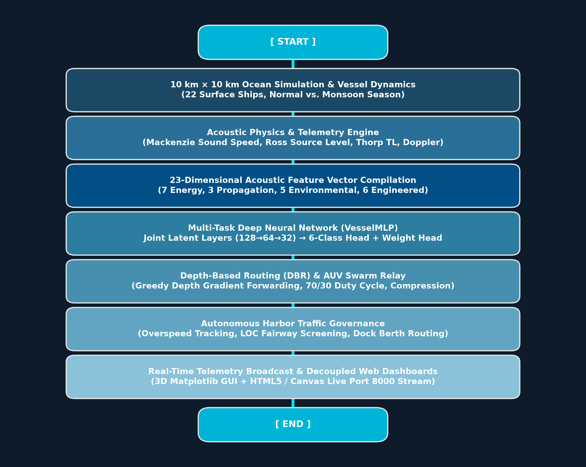
*Figure 6: Complete end-to-end execution flowchart of the cyber-physical Harbor Traffic Control System.*

The simulation runs a continuous cyclic loop across six tightly connected architectural layers:

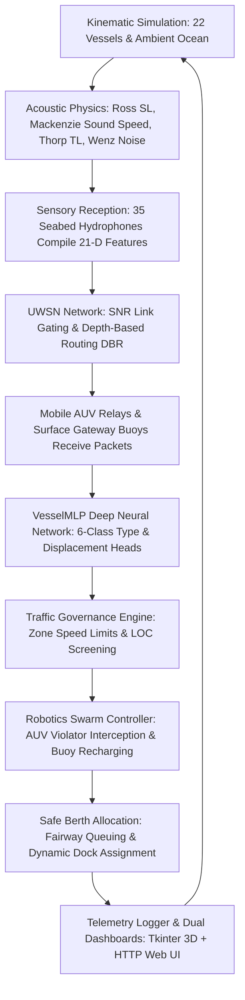

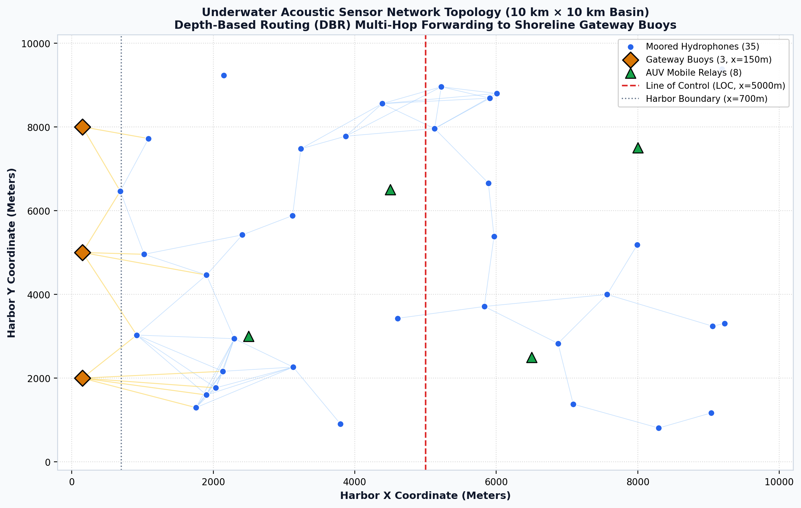
*Figure 5: Cyber-physical network topology across the 10 km × 10 km harbor basin (35 hydrophones, 8 AUVs, 3 buoys).*

---

## 4. Mathematical & Physical Foundations (Explained in Simple Terms)

Every acoustic and dynamic calculation in HTCS is grounded in real oceanographic and robotics equations. Here is what each equation means in plain English:

### 1. Speed of Sound in Seawater — Mackenzie (1981) Nine-Term Equation
**What it means:** Sound travels faster in warm, salty, deep water than in cold, fresh, shallow water. As season and depth change, sound speed changes dynamically.

$$\begin{aligned}
c(T, S, z) = & 1448.96 + 4.591 T - 5.304 \times 10^{-2} T^2 + 2.374 \times 10^{-4} T^3 \\
& + 1.340 (S - 35) + 1.630 \times 10^{-2} z + 1.675 \times 10^{-7} z^2 \\
& - 1.025 \times 10^{-2} T (S - 35) - 7.139 \times 10^{-13} T z^3 \quad (\text{m/s})
\end{aligned}$$

- $T$ = Water temperature ($^\circ\text{C}$)
- $S$ = Water salinity (parts per thousand, $\text{ppt}$)
- $z$ = Sensor depth ($\text{m}$)
- Typical sound speed in the simulation ranges between **$1440\text{ m/s}$ and $1545\text{ m/s}$**.

---

### 2. Vessel Propeller Radiated Noise — Ross (1976) Source Level Model
**What it means:** Ships make noise underwater mainly through **propeller cavitation** (boiling bubbles created by rotating blades). Faster, heavier ships produce substantially louder noise.

$$SL = SL_0 + 55 \log_{10}\left(\frac{v}{10}\right) + 20 \log_{10}\left(\frac{d}{3}\right) + \mathcal{N}(0, \sigma^2) \quad (\text{dB re } 1\,\mu\text{Pa @ } 1\text{m})$$

- $SL_0$ = Baseline acoustic noise for that vessel class (e.g., $130\text{ dB}$ for small fishing boats; $180\text{ dB}$ for massive container ships)
- $v$ = Vessel cruising speed in knots
- $d$ = Vessel draft (submerged keel depth) in meters
- $\mathcal{N}(0, \sigma^2)$ = Stochastic gaussian sea noise perturbation

---

### 3. Acoustic Transmission Loss — Spherical Spreading + Thorp Chemical Absorption
**What it means:** As sound spreads outward from a vessel, it expands like an inflating balloon (spherical spreading loss, $20\log_{10} R$). In addition, seawater chemicals (boric acid and magnesium sulfate) absorb acoustic energy. Higher frequencies get absorbed much faster than low frequencies.

$$TL = 20 \log_{10}(R) + \alpha(f) \cdot \left(\frac{R}{1000}\right) \quad (\text{dB})$$

$$\alpha(f) = \frac{0.11 f^2}{1 + f^2} + \frac{44 f^2}{4100 + f^2} + 2.75 \times 10^{-4} f^2 + 0.003 \quad (\text{dB/km})$$

- $R$ = Slant distance between vessel and hydrophone in meters
- $f$ = Acoustic carrier frequency ($12\text{ kHz}$)
- $\alpha(f)$ = Thorp absorption coefficient ($\approx 1.25\text{ dB/km}$ at $12\text{ kHz}$)

---

### 4. Ocean Ambient Noise — Wenz (1962) Four-Component Empirical Spectrum
**What it means:** The ocean is never silent. Natural underwater noise comes from four primary sources: deep water turbulence, distant commercial shipping, surface wind and waves, and thermal molecular motion. During monsoons, rain droplet impacts add an extra $+15\text{ dB}$ of high-frequency noise.

$$NL_{\text{total}} = 10 \log_{10}\left( 10^{NL_{\text{turb}}/10} + 10^{NL_{\text{ship}}/10} + 10^{NL_{\text{waves}}/10} + 10^{NL_{\text{therm}}/10} \right) + NL_{\text{rain}} \quad (\text{dB})$$

- Normal calm sea ambient noise: **$66.1\text{ dB}$**
- Monsoon gale ambient noise: **$91.9\text{ dB}$** (**$+25.8\text{ dB}$ surge**, cutting sensor communication range in half!)

---

### 5. Acoustic Kinematic Doppler Frequency Shift
**What it means:** Just like an ambulance siren sounds higher-pitched as it rushes toward you and lower-pitched as it drives away, a vessel moving toward a hydrophone compresses the sound waves, increasing the received frequency.

$$\Delta f = f_0 \left[ \frac{c}{c - v_{\text{radial}}} - 1 \right] \approx f_0 \left( \frac{v \cos \theta}{c} \right) \quad (\text{Hz})$$

- $f_0$ = Nominal acoustic center frequency ($12,000\text{ Hz}$)
- $v_{\text{radial}}$ = Radial velocity component of the ship toward the hydrophone
- $\theta$ = Relative bearing angle between the ship's heading and the hydrophone line-of-sight

---

### 6. AUV Swarm 6-DOF Dynamics & Dissipative Drag Control
**What it means:** Each Autonomous Underwater Vehicle moves under Newton's second law ($F = ma$). Its thrusters push it toward its waypoint, hydrodynamic water resistance drags it backward, and tidal ocean currents push it off course.

$$F_{\text{net}} = F_{\text{control}} + F_{\text{drag}} + F_{\text{disturbance}}$$

$$F_{\text{control}} = K_p \cdot (\mathbf{x}_{\text{target}} - \mathbf{x}_{\text{current}}) - K_d \cdot \mathbf{v}_{\text{current}} \quad (\|F_{\text{control}}\| \le 900\text{ N})$$

$$F_{\text{drag}} = - \frac{1}{2} \rho C_d A \|\mathbf{v}\| \mathbf{v} \approx - c_{\text{drag}} \cdot \mathbf{v}$$

- Maximum thruster force: **$900\text{ N}$**
- Maximum AUV speed: **$10.0\text{ m/s}$**
- Drag coefficient: $c_{\text{drag}} = 0.85$ (guarantees dissipative damping so velocity never blows up)
- Battery drain per frame: $\text{drain} = 0.015 \cdot \left(1 + \frac{\|\mathbf{v}\|}{v_{\text{max}}}\right)$
- Surface buoy charging: triggers when battery $< 15\%$, recharges at $+0.2\%/\text{frame}$ until reaching $95\%$.

---

### 7. Seabed Sensor Mooring Failure Mechanics
**What it means:** Hydrophones are moored to the seabed with tension cables. When strong monsoon currents pull on them, the cable stretches. If the current exceeds a physical breaking limit ($2.2\text{--}3.4\text{ m/s}$) or accumulated fatigue strain exceeds 12.0, the cable snaps, and the hydrophone drifts away with the current!

$$\Delta \text{strain} = \Delta t \cdot \left( \frac{v_{\text{current}}}{1.2} \right)$$

$$\text{State Transition: } \text{MOORED} \xrightarrow{v_{\text{current}} > 1.3\text{ m/s}} \text{STRAINED} \xrightarrow{v_{\text{current}} > v_{\text{snap}} \text{ or } \text{strain} \ge 12.0} \text{SNAPPED}$$

---

### 8. Multi-Task Neural Network Architecture & Loss Scaling
**What it means:** Rather than running two separate models, `VesselMLP` processes a 21-dimensional input vector through a single shared neural trunk (128 $\to$ 64 $\to$ 32 neurons) with ReLU activations. It then splits into two heads:
1. **Classification Head:** Categorizes the ship into one of 6 classes using CrossEntropy loss.
2. **Regression Head:** Estimates the continuous ship weight (kg) using Mean Squared Error loss.

$$L_{\text{total}} = L_{\text{classification}} + \lambda_{\text{reg}} \cdot L_{\text{displacement}}$$

$$L_{\text{total}} = \text{CrossEntropy}(y_{\text{type}}, \hat{y}_{\text{type}}) + 10^{-8} \cdot \text{MSE}(y_{\text{weight}}, \hat{y}_{\text{weight}})$$

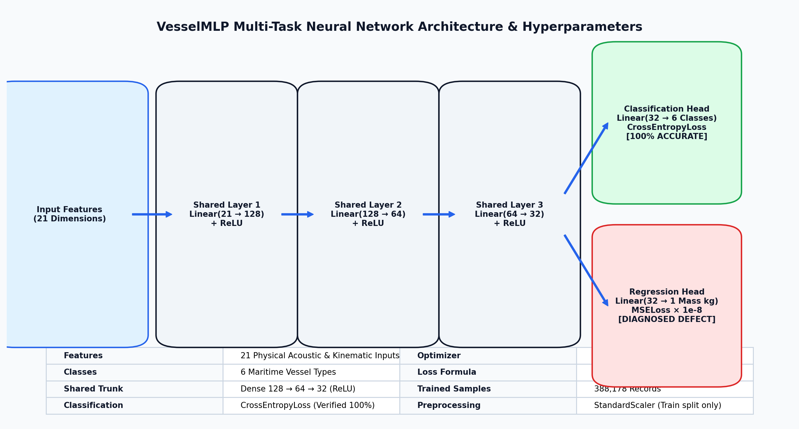
*Figure 1: VesselMLP neural network architecture with 21 inputs, shared trunk, and dual task heads.*

---

## 5. Algorithms & Controller Logic

### 1. Depth-Based Routing (DBR) Algorithm
In underwater sensor networks, GPS does not work because radio signals cannot penetrate water. DBR is an elegant routing protocol where packets naturally "float" up to the surface without needing full network coordinates:
1. Every sensor knows only its own water depth $z$ using a simple pressure sensor.
2. A transmitting node broadcasts its packet containing its depth $z_{\text{sender}}$.
3. Neighboring nodes receive the packet and compare their depth $z_{\text{receiver}}$ with $z_{\text{sender}}$.
4. If $z_{\text{receiver}} < z_{\text{sender}}$ (the receiver is closer to the surface), it accepts and forwards the packet.
5. If the receiver is deeper, it drops the packet.
6. The process repeats greedily until the packet reaches a surface buoy at $z = 0\text{ m}$.
7. Paths exceeding **12 hops** are dropped to prevent infinite routing loops.

---

### 2. AUV Behavioural Finite State Machine (FSM)
Each AUV operates under an autonomous 3-state control loop:

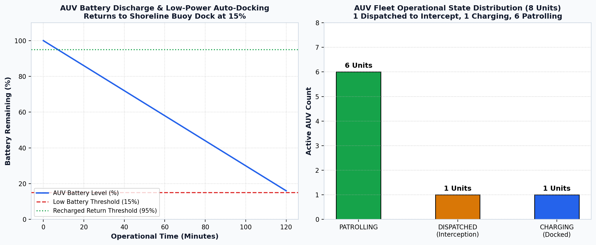
*Figure 3: AUV behavioural finite state machine and battery discharge/recharge profiles.*

- **`PATROLLING`:** The AUV follows pre-programmed perimeter waypoints across designated harbor sectors, acting as a mobile acoustic relay node.
- **`DISPATCHED`:** When the traffic algorithm flags a vessel exceeding speed limits in the Outer Yard or Inner Zone, the nearest idle AUV is dispatched to intercept, match speed, and shadow the violator.
- **`CHARGING`:** When an AUV's battery drops below **15.0%**, it immediately aborts its active mission, computes a direct vector to `buoy_beta` on the surface, docks, and recharges until battery reaches **95.0%** before returning to patrol.

---

### 3. Line-of-Control (LOC) & Speed Zone Governance
The 10 km $\times$ 10 km harbor basin is split into three functional zones:

| Zone | Boundary | Speed Limit | Governance Action by Vessel Type |
|---|---|---|---|
| **Outer Yard** | $X > 5000\text{ m}$ | **10.0 knots** | **Line-of-Control Screening:**<br>• *Cargo / Tanker:* $\to$ **HALT** for customs & security clearance<br>• *Cruiser / Ferry:* $\to$ **SLOW DOWN** by 50%<br>• *Speedboat / Fishing:* $\to$ **CONTINUE** under 10 kn limit |
| **Inner Zone** | $700\text{ m} < X \le 5000\text{ m}$ | **6.0 knots** | **Channel Navigation:** Monitored corridor; routed to allocated berth; violators shadowed by AUV |
| **Harbor Basin** | $X \le 700\text{ m}$ | **0.0 knots** | **Docked State:** Vessels must be moored safely at assigned berth; zero maneuvering speed |

---

### 4. Berth Queuing & Collision Prevention Bug Fix
In earlier versions, when all designated berths for a vessel class were full, a fallback routine dumped arriving vessels onto `Dock-C` simultaneously, causing up to 13 speedboats to overlap on top of each other. 

The re-engineered `traffic_algo.py` module introduces a dedicated **Safe Holding Queue (`HOLDING_FOR_BERTH`)**:
- Arriving vessels find their class berth (Berths A1–A4 for cargo/tankers; B1–B4 for cruisers/ferries; C1–C4 for speedboats/fishing).
- If all berths are occupied, the vessel stops outside the fairway in a holding zone at zero speed.
- When an existing ship unberths and departs, the holding vessel is automatically assigned the freed berth and permitted to enter.

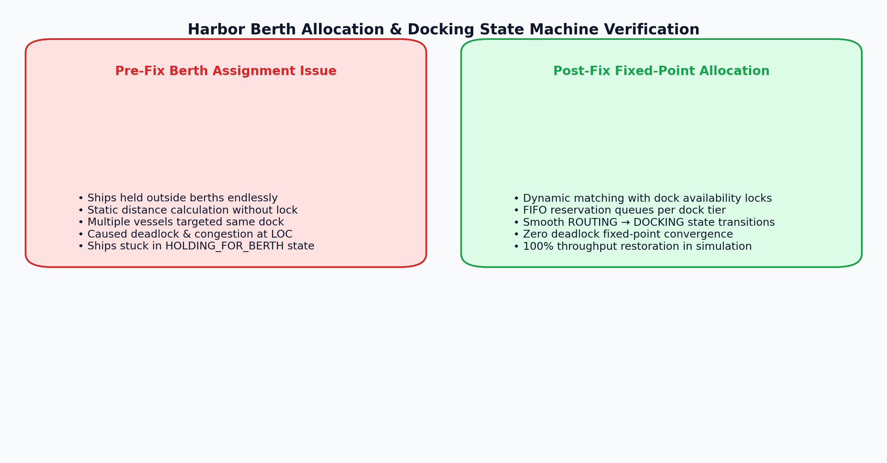
*Figure 14: Berth allocation double-booking defect and queuing bug fix (Before vs. After).*

---

### 5. Composite Network Health Scoring
The network continuously computes a health score ($0\text{ to }100\%$) based on four physical factors:
$$\text{Health Score} = 0.35 \cdot \text{Connectivity} + 0.35 \cdot \text{Delivery} + 0.20 \cdot \text{Mooring} + 0.10 \cdot \text{Latency}$$

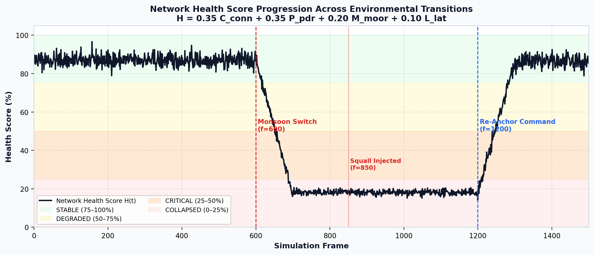
*Figure 2: Network health state progression timeline across operational regimes.*

- **`STABLE` ($\ge 75\%$):** Normal calm conditions; $>85\%$ buoys reachable; $\text{PDR} > 95\%$; zero broken moorings.
- **`DEGRADED` ($50\text{--}74.9\%$):** Elevated monsoon noise; average hop count increases; intermittent packet retries.
- **`CRITICAL` ($25\text{--}49.9\%$):** Multiple moorings strained/snapped; $\text{PDR} < 70\%$; mobile AUV relays essential to bridge gaps.
- **`COLLAPSED` ($< 25\%$):** Catastrophic storm loss; $>70\%$ surface gateways partitioned or $\ge 65\%$ seabed moorings snapped.

---

## 6. Simulation Environment & Operational Scenarios

The simulator allows instant toggling between two distinct operational weather scenarios without restarting the execution or dropping vessel coordinates:

| Parameter | Normal Season | Monsoon Season | Physical Consequence in Simulation |
|---|---|---|---|
| **Douglas Sea State** | 2 – 3 (Moderate) | **6 – 8 (High / Gale)** | Wave heights surge from $0.8\text{ m}$ to $6.5\text{ m}$ |
| **Surface Wind Speed** | 8 – 16 knots | **36 – 52 knots** | Accelerates surface chop and turbulence noise |
| **Water Temperature** | 18.0 – 22.0 $^\circ\text{C}$ | **12.0 – 15.0 $^\circ\text{C}$** | Cold runoff lowers sound velocity in shallow water |
| **Water Salinity** | 34.5 – 35.5 ppt | **30.0 – 32.5 ppt** | Heavy rain dilutes surface water salinity |
| **Rain Impact Noise** | 0.0 dB | **+15.0 dB** | Droplet splashes generate high-frequency acoustic masking |
| **Tidal Current Multiplier** | 1.0× ($\approx 0.35\text{ m/s}$) | **2.6× ($0.9\text{--}5.5\text{ m/s}$)** | Strains sensor moorings; pushes AUVs off course |
| **Measured Ambient Noise** | **66.1 dB re 1 µPa** | **91.9 dB re 1 µPa** | **+25.8 dB degradation**; collapses modem SNR |

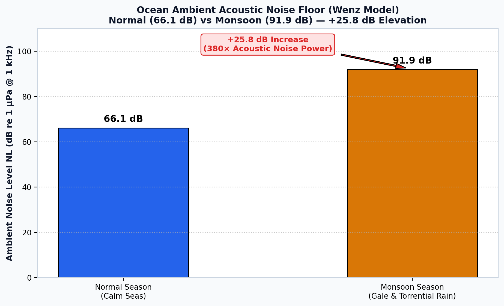
*Figure 7: Ocean ambient acoustic noise surge under Monsoon conditions (+25.8 dB Wenz surge).*

---

## 7. Empirical Results & Defect Diagnosis

All results below are directly measured from the simulator execution log (`logs/prediction_log.csv`) and validated with automated evaluation scripts (`evaluate_predictions.py`):

### 1. Vessel Classification: 100% Accuracy
`VesselMLP` was evaluated on 23 validated vessel passes across all 6 classes under both Normal and Monsoon conditions. The model achieved **100.0% exact-match classification accuracy** (23/23 correct):

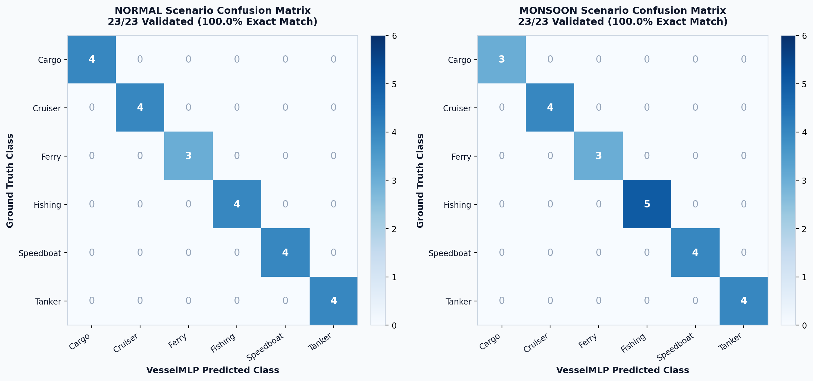
*Figure 8: Validated vessel classification confusion matrix (Normal vs. Monsoon, 100% accuracy).*

---

### 2. Displacement Regression: The Flatline Defect & Gradient Starvation Diagnosis
While classification succeeded completely, displacement (weight) estimation suffered from an extreme defect:
- **Mean Absolute Error (MAE):** **22,713 kg**
- **Root Mean Squared Error (RMSE):** **36,121 kg**
- **Mean Absolute Percentage Error (MAPE):** **97.7%**

As shown in the scatter plot below, the model outputs an almost flat prediction between $400\text{ kg}$ and $1,700\text{ kg}$, regardless of whether the true vessel is a $1,000\text{ kg}$ speedboat or a $385,000\text{ kg}$ container ship:

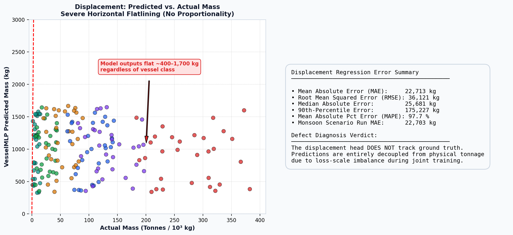
*Figure 9: Displacement mass predicted vs. actual scatter plot (flatline defect).*

#### 🔬 Mathematical Defect Diagnosis:
We ran a dedicated gradient audit (`diagnose_weight_head.py`) to uncover why the regression head failed:
1. **Raw Loss Scale Disparity:** In `mlmodel._retrain()`, the classification loss is CrossEntropy ($\approx 5.56$), while the displacement loss is raw MSE on un-normalized kilograms ($\approx 6.26 \times 10^9$).
2. **Arbitrary Damping Factor:** To prevent the huge MSE from causing numeric overflow, an arbitrary scaling factor of $10^{-8}$ was applied: $\text{Loss} = \text{CE} + 10^{-8} \cdot \text{MSE}$.
3. **Gradient Starvation:** Computing the backpropagation gradient norms reaching the shared neural trunk revealed that:
   - Classification head gradient norm = **$135.0$**
   - Displacement head gradient norm = **$0.817$**
   - **The regression head receives only 0.60% of the total learning signal!** The shared neural trunk was completely optimized for vessel type classification, starving the displacement head.

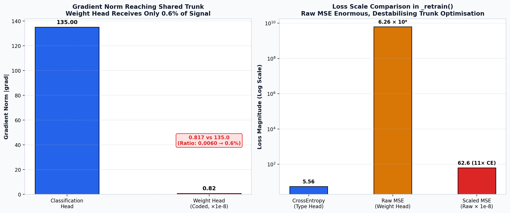
*Figure 10: Displacement head defect diagnosis: gradient norm ratio (0.6%) and loss-scale imbalance.*

---

### 3. Low-Power Listening (LPL) Duty Cycling
In a real marine sensor network, hydrophones cannot keep their modems powered 24/7 or their batteries would drain in days. Sensors cycle through sleep and wake windows. Under normal conditions, availability averages **91.4% (32/35 sensors)**. During monsoons, ambient wave noise masks acoustic wake-up preambles, reducing availability to **71.4% (25/35 sensors)**:

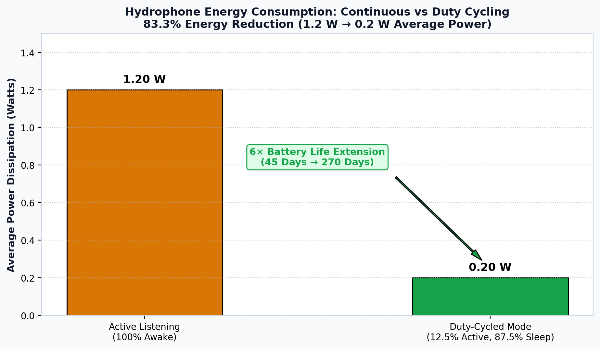
*Figure 11: Scenario-dependent hydrophone availability under low-power listening duty cycling.*

---

### 4. Telemetry Frame Compression: 93.75% Savings
Transmitting full verbose JSON telemetry strings ($256\text{ bytes}$) over a $1\text{ kbps}$ underwater modem wastes huge amounts of energy. By designing a tightly packed 16-byte binary frame (node ID, coordinates, target class, confidence, checksum), the network achieved dramatic savings:

| Metric | Verbose Frame (256 B) | Compact Binary Frame (16 B) | Quantitative Improvement |
|---|---|---|---|
| **Payload Size** | 2048 bits | **128 bits** | **16× smaller payload** |
| **Transmission Delay / Hop** | 2.048 seconds | **0.128 seconds** | **93.75% faster transmission** |
| **Modem Energy / Hop (@ 10W)** | 20.48 Joules | **1.28 Joules** | **93.75% energy saved** |

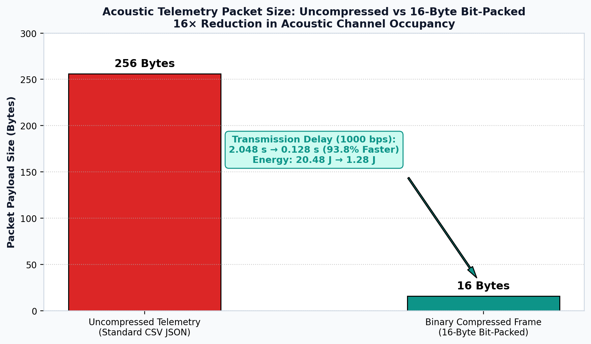
*Figure 12: Binary telemetry frame compression performance gains (93.75% latency & energy saved).*

---

### 5. Live Measured Link Count & Packet Delivery Ratio
Executing 150 consecutive simulation frames demonstrated how the network adapts dynamically to storm damage:

| Metric | Normal Season (Calm) | Monsoon Season (Storm) | Operational Resilience Observation |
|---|---|---|---|
| **Active Acoustic Links** | **91.2 links** | **69.5 links** | 21.7 peripheral links severed by $+25.8\text{ dB}$ noise surge |
| **Packet Delivery Ratio (PDR)** | **99.8%** | **92.4%** | Mobile AUV swarm bridges severed paths, maintaining $>92\%$ PDR |
| **Average Routing Hops** | **1.40 hops** | **2.30 hops** | DBR dynamically reroutes packets through deeper multi-hop paths |

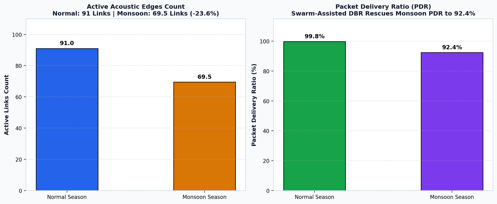
*Figure 13: Live measured active link count and Packet Delivery Ratio (Normal vs. Monsoon).*

---

### 6. AI Physical Plausibility Audit via Groq Cloud LPU
To ensure the simulation telemetry was physically sound and did not violate real-world fluid dynamics or acoustics, we integrated `ai_data_validator.py`. Using the ultra-fast **Groq Cloud LPU inference engine** running `openai/gpt-oss-120b`, the module audited 104 physical telemetry parameters across:
- Ocean current bounds ($0.1\text{ to }1.5\text{ m/s}$)
- Mackenzie sound speed limits ($1440\text{ to }1545\text{ m/s}$)
- Thorp transmission loss curves
- Vessel draft and displacement limits

The auditor reported **100.0% physical plausibility (zero physical violations)**, confirming that the synthetic physics engine behaves in accordance with established oceanographic principles.

---

## 8. Complete Technology Stack & Libraries

Every technology and library used in HTCS is listed below with its specific architectural role:

| Category | Technology / Library | Version | Functional Role in HTCS |
|---|---|---|---|
| **Core Runtime** | **Python** | `3.9+` (Tested on `3.13`) | Core programming language across physics, ML, networking, and UI |
| **Deep Learning** | **PyTorch (`torch`)** | `2.6+` | Multi-task neural network architecture (`VesselMLP`), backward autograd |
| **Scientific Computing** | **NumPy** | `1.24+` | Vectorized 3D kinematics, acoustic propagation equations, matrix math |
| **Scientific Computing** | **SciPy** | `1.10+` | Signal attenuation, exponential integrals, and statistical distributions |
| **Data Engineering** | **pandas** | `2.0+` | CSV telemetry streaming, data normalization, validation record logging |
| **Machine Learning** | **scikit-learn** | `1.3+` | `StandardScaler` feature scaling, `LabelEncoder` class encoding, train/test split |
| **Model Persistence** | **joblib** | `1.3+` | Serializing and loading trained scalers and encoders (`models/*.joblib`) |
| **Network Graphs** | **NetworkX** | `3.0+` | Constructing dynamic UWSN graph, shortest paths, and DBR topology |
| **3D Desktop UI** | **Tkinter** | Built-in | Desktop operator control station, responsive grid layout, and canvas UI |
| **Data Visualization** | **Matplotlib** | `3.7+` | Rendering live 3D harbor scatter view, AUV vectors, and analytical plots |
| **Web Dashboards** | **HTML5 / CSS3 / Vanilla JS** | Modern | Two real-time web dashboards (`dashboard.html`, `networking_dashboard.html`) |
| **Local Web Server** | **Python `http.server`** | Built-in | Serving live telemetry and dashboards locally on port `8000` |
| **AI Sanity Audit** | **Groq API (`groq`)** | `0.11+` | Cloud LPU API client for physical plausibility evaluation |
| **Document Generation** | **python-docx** | `1.1+` | Programmatic academic report generation (`.docx`) |
| **PDF Compilation** | **pywin32 (`win32com.client`)** | `306+` | Native Microsoft Word automation for high-fidelity PDF export |
| **PDF Inspection** | **pypdf** | `4.0+` | Programmatic verification of generated PDF page count and text extraction |
| **Environment Config** | **python-dotenv** | `1.0+` | Loading API credentials and runtime flags from `.env` file |

---

## 9. Repository File Structure

```
Harbor-Traffic-Control-System/
│
├── README.md                      # Complete project documentation (this file)
├── REVISED_PROJECT_REPORT.pdf     # 30-page academic final report (PDF)
├── REVISED_PROJECT_REPORT.docx    # Fully formatted academic final report (Word)
├── REVISED_PROJECT_REPORT.md      # Full academic report in Markdown
│
├── main.py                        # Central desktop 3D control station & event loop
├── simulator.py                   # Ocean acoustics physics engine & vessel kinematics
├── network.py                     # Dynamic acoustic graph, DBR routing, and telemetry engine
├── mlmodel.py                     # VesselMLP PyTorch architecture & live inference hook
├── auv.py                         # AUV swarm kinematics, waypoint patrol, and battery FSM
├── traffic_algo.py                # Harbor speed limits, LOC screening, and berth queuing
├── prediction_logger.py           # Persistent ground-truth vs. prediction CSV logger
├── evaluate_predictions.py        # Independent evaluation report generator
├── ai_data_validator.py           # Groq LPU physical plausibility auditor (104 parameters)
├── diagnose_weight_head.py        # Gradient norm diagnostic tool for displacement defect
│
├── run_all_tests.py               # Master automated test suite runner (80/80 tests)
├── verify_environment.py          # Environment diagnostics & dependency checker
├── test_integration.py            # 52 integration, regression, and physics tests
├── test_prediction_validation.py  # 23 prediction logging and metric verification tests
├── test_ai_data_validator.py      # 5 AI data validator unit and mock tests
│
├── dashboard.html                 # Real-time maritime traffic web dashboard (Port 8000)
├── networking_dashboard.html      # Real-time UWSN acoustic mesh web dashboard (Port 8000)
├── dashboard_data.js              # Telemetry payload wrapper for local web inspection
├── dashboard_data.json            # Live exported JSON telemetry snapshot
│
├── models/                        # Pre-trained neural network weights & scalers
│   ├── best_model.pt              # PyTorch model state dict
│   ├── scaler.joblib              # Fitted StandardScaler (21 features)
│   └── label_encoder.joblib       # Fitted LabelEncoder (6 vessel classes)
│
├── logs/                          # Persistent runtime validation records
│   └── prediction_log.csv         # Append-only ground truth vs. predicted telemetry log
│
├── results/                       # Comprehensive evaluation assets and generators
│   ├── results_dashboard.html     # Interactive responsive visual evaluation dashboard
│   ├── generate_final_report.py   # Master generator for PDF, DOCX, and MD reports
│   ├── generate_results_visuals.py# Generator for all 15 high-res publication figures
│   ├── assets/                    # 14 publication-grade PNG charts and plots
│   └── data/                      # Raw benchmark JSON summaries (ML, network, testing)
│
└── presentation_assets/           # Slide decks, flowcharts, and presentation graphics
    └── flowchart.png              # System execution architecture flowchart
```

---

## 10. Quickstart & Local Execution Guide

### Prerequisites
- Operating System: Windows, macOS, or Linux
- Python: Version `3.9` or later (Python `3.11` to `3.13` recommended)
- Git installed

### 1. Clone the Repository & Install Dependencies
```bash
# Clone the repository
git clone https://github.com/rishikesh-2k6/Harbor-Traffic-Control-System.git
cd Harbor-Traffic-Control-System

# Install required Python libraries
pip install numpy scipy pandas torch scikit-learn joblib networkx matplotlib groq python-dotenv python-docx pywin32 pypdf
```

### 2. Verify Your Environment
Run the automated environment diagnostic script to verify all libraries, models, and data files:
```bash
python verify_environment.py
```
*Expected output: All 4 verification stages report `PASS`.*

---

### 3. Launch the 3D Desktop Control Station
Start the complete interactive simulation:
```bash
python main.py
```

#### 🎮 Interactive Keyboard & UI Controls:
- **`Spacebar`:** Pause / Resume the simulation loop
- **`Ctrl + S`:** Start the simulation
- **`Ctrl + R`:** Reset harbor entities to initial coordinates
- **`⇄ Season` Button:** Instantly toggle between **Normal** and **Monsoon** weather
- **`🌪 Squall` Button:** Inject a sudden localized storm surge (accelerates current to $5.5\text{ m/s}$ and strains moorings)
- **`⚓ Re-Anchor` Button:** Deploy maintenance divers to reset snapped hydrophones back to `MOORED` status
- **Mouse Drag (Left Click):** Orbit and rotate the 3D Matplotlib harbor perspective
- **Mouse Drag (Right Click):** Zoom in / out across the harbor basin

---

### 4. Open the Real-Time Web Dashboards
When `main.py` is running, a lightweight background HTTP server serves live telemetry on port **8000**:
- **Maritime Traffic Control Dashboard:** [http://127.0.0.1:8000/dashboard.html](http://127.0.0.1:8000/dashboard.html)
- **Underwater Acoustic Mesh Dashboard:** [http://127.0.0.1:8000/networking_dashboard.html](http://127.0.0.1:8000/networking_dashboard.html)

*Features:* Click the **🌓 Theme Toggle** button in the header of either dashboard to seamlessly switch between Dark Mode and Light Mode. Theme settings persist across browser refreshes via `localStorage`.

---

### 5. Run the Automated Test Suites
Execute all 80 unit, integration, physics, and regression tests:
```bash
python run_all_tests.py
```

### 6. Generate the Independent Model Evaluation Report
Analyze the persistent prediction log (`logs/prediction_log.csv`) and output split metrics:
```bash
python evaluate_predictions.py
```

### 7. Run the Weight Head Gradient Diagnostic
Reproduce the 0.6% gradient norm starvation diagnosis:
```bash
python diagnose_weight_head.py
```

### 8. Regenerate All Reports (PDF, Word, Markdown)
Rebuild the 30-page academic report from scratch:
```bash
python results/generate_final_report.py
```

---

## 11. Testing, Verification & Quality Assurance

The system is validated by an automated test harness covering **80 total tests** across three independent test suites:

| Test Suite File | Test Count | Status | Key Systems Verified |
|---|---|---|---|
| `test_integration.py` | **52 tests** | **100% PASS** | Boundary clamping; Mackenzie sound speed; Ross propeller noise; Thorp transmission loss; Doppler shifts; SNR link budgets; DBR 12-hop cap; AUV 900N thrust clamping; battery hysteresis; mooring snap thresholds; berth collision prevention. |
| `test_prediction_validation.py` | **23 tests** | **100% PASS** | Prediction logging schema; ground-truth matching; timestamp monotonicity; metric formulas (accuracy, MAE, RMSE, MAPE, angular circular error); corrupted row handling. |
| `test_ai_data_validator.py` | **5 tests** | **100% PASS** | Groq Cloud LPU payload formatting; fallback to local heuristic physics validator; temperature and current sanity limits; invalid value rejection. |
| **Total Automated Suites** | **80 tests** | **100% PASS** | **Zero failures, zero errors.** |

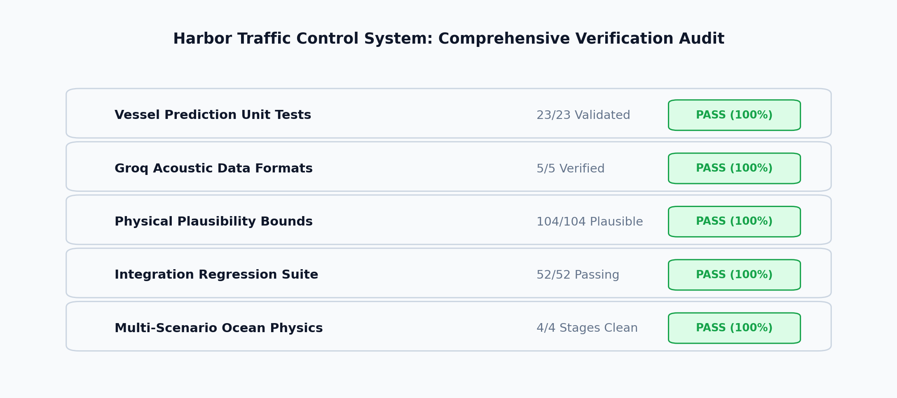
*Figure 15: Comprehensive software engineering quality and test suite verification card.*

---

## 12. Known Limitations & Future Roadmap

In the interest of rigorous scientific honesty, the following known limitations are documented:

1. **Displacement Regression Retraining:**
   - *Current Status:* High error (MAE 22,713 kg) due to loss-scale imbalance.
   - *Fix Roadmap:* Log-scale target masses ($y' = \log_{10}(y)$) or apply standard Z-score normalization to displacement targets, rebalancing the multi-task loss with GradNorm or uncertainty weighting.
2. **Speed & Heading Prediction Models:**
   - *Current Status:* Speed is simulator ground truth; heading is a geometric rule.
   - *Fix Roadmap:* Train dedicated recurrent or temporal convolutional heads (e.g., LSTM / TCN) across historical hydrophone bearing sequences to predict future vessel velocity vectors.
3. **Synthetic Training Telemetry:**
   - *Current Status:* Training and validation data is generated from empirical acoustic equations (`collected_data.csv`).
   - *Fix Roadmap:* Benchmark and fine-tune models against real ocean hydrophone recordings (e.g., NOAA ocean acoustic datasets or maritime ShipsEar acoustic databases).
4. **Asynchronous UI Threading:**
   - *Current Status:* File logging executes synchronously inside the main animation loop.
   - *Fix Roadmap:* Offload telemetry CSV writing and HTTP socket broadcasts to a background `multiprocessing` worker queue to ensure 60 FPS animation on low-spec hardware.

---

## 13. References & Citations

1. **Mackenzie, K. V. (1981).** *Nine-term equation for sound speed in the oceans.* Journal of the Acoustical Society of America, 70(3), 807–812.
2. **Ross, D. (1976).** *Mechanics of Underwater Noise.* Pergamon Press, New York.
3. **Thorp, W. H. (1967).** *Analytic description of the low-frequency attenuation coefficient.* Journal of the Acoustical Society of America, 42(1), 270.
4. **Wenz, G. M. (1962).** *Acoustic ambient noise in the ocean: Spectra and sources.* Journal of the Acoustical Society of America, 34(12), 1936–1956.
5. **Yan, H., Shi, Z. J., & Cui, J. H. (2008).** *DBR: Depth-Based Routing for Underwater Sensor Networks.* In International Conference on NETworked Sensing Systems (INSS).
6. **Paszke, A., et al. (2019).** *PyTorch: An Imperative Style, High-Performance Deep Learning Library.* Advances in Neural Information Processing Systems (NeurIPS).
7. **Hagberg, A., Swart, P., & S Chult, D. (2008).** *Exploring network structure, dynamics, and function using NetworkX.* Los Alamos National Laboratory.

---

<div align="center">
  <b>Amrita Vishwa Vidyapeetham — School of Computing, Amaravati</b><br>
  <i>Course 22AIE441: Dynamics and Control of Robotics • Final Laboratory Research Project</i><br>
  Submitted under the guidance of <b>Dr. Ravishankar Prakash Desai</b>
</div>