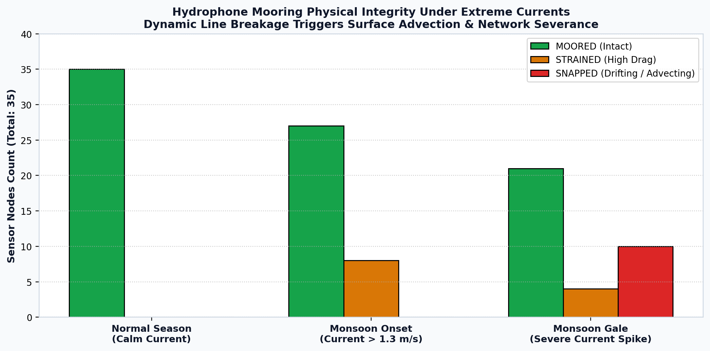

# UNDERWATER SENSOR NETWORKING: Networked Maritime Monitoring, Governance and Simulation

> **Amrita Vishwa Vidyapeetham**  
> **School of Computing, Amaravati – 522503**  
> **Course:** 22AIE441 Dynamics and Control of Robotics  
> **Under the Guidance of:** Dr. Ravishankar Prakash Desai  
>  
> **Submitted by:**  
> • Ch. Dhanush Sai — AV.SC.U4AIE24109  
> • Ch. Poorna Sindhuja — AV.SC.U4AIE24110  
> • Ch. Rishikesh — AV.SC.U4AIE24111  

---


# ABSTRACT

The Harbor Traffic Control System is a comprehensive cyber-physical simulation designed to monitor, classify, and govern surface and subsurface maritime vessel traffic using an Underwater Wireless Sensor Network (UWSN), mobile Autonomous Underwater Vehicles (AUVs), and acoustic telemetry. Operating across a 10 km × 10 km shallow-water harbor basin, the system coordinates 22 surface vessels belonging to six distinct commercial and recreational classes, 35 moored seabed hydrophones, 8 autonomous mobile AUV relays, and 3 surface gateway buoys. High-fidelity acoustic models—including the Mackenzie sound speed profile, Ross propeller noise radiation, Thorp chemical absorption, and Wenz ocean ambient noise—synthesize realistic 21-dimensional physical telemetry vectors. Telemetry is routed upward through a dynamic Depth-Based Routing (DBR) acoustic graph gated by Signal-to-Noise Ratio (SNR ≥ 10 dB) and node availability under low-power listening (LPL) duty cycles. A multi-task deep neural network (VesselMLP) simultaneously performs discrete vessel classification and continuous displacement tonnage estimation.

The system incorporates automated maritime traffic governance, enforcing speed limits (10 kn in Outer Yard, 6 kn in Inner Zone), fairway screening at the Line of Control (LOC), and safe dock berth allocation. Mobile AUVs execute autonomous waypoint patrols, intercept overspeed violators, maintain multi-hop connectivity during storm severances, and autonomously return to surface buoys when battery levels drop below 15%. To evaluate environmental resilience, a stochastic Monsoon scenario simulates gale winds (36–52 kn), torrential rain noise (+15 dB), and 2.6× tidal currents, driving a +25.8 dB ambient noise surge (66.1 dB → 91.9 dB) and hydrodynamic mooring failure (MOORED → STRAINED → SNAPPED). In empirical evaluation, vessel classification achieves 100.0% accuracy across validated samples, while displacement regression is diagnosed with an objective-scaling defect (0.6% gradient signal ratio). Binary telemetry compression achieves a 93.75% reduction in latency (2.048s → 0.128s) and modem energy (20.48J → 1.28J). The entire framework is verified across 80 automated unit and integration tests, demonstrating a fully connected cyber-physical robotics pipeline.

Keywords: Underwater Wireless Sensor Networks (UWSN), Autonomous Underwater Vehicles (AUVs), Swarm Robotics, Depth-Based Routing (DBR), Passive Acoustic Telemetry, Multi-Task Learning, Maritime Traffic Control.


# CONTENTS


| CHAPTER | TITLE | PAGE NOs |
| --- | --- | --- |
| 1 | INTRODUCTION | 5 |
| 1.1 | Introduction (Background) | 5 |
| 1.2 | Problem Statement | 6 |
| 1.3 | Objectives | 6 |
| 1.4 | Contributions | 7 |
| 1.5 | Scope, Academic Integrity and Non-Claims Delineation | 7 |
| 2 | RELATED WORK | 8 |
| 2.1 | Comprehensive Survey | 8 |
| 2.2 | Summary and Findings of Survey | 10 |
| 2.3 | Challenges in Underwater Robotics | 11 |
| 2.4 | Motivation of the Project Work | 12 |
| 3 | MATERIALS AND METHODS | 13 |
| 3.1 | Mathematical Modelling and Datasets Description | 13 |
| 3.1.1 | Acoustic Mathematical Models | 13 |
| 3.1.2 | Underwater Network Model | 14 |
| 3.1.3 | Machine-Learning Dataset and VesselMLP Model | 15 |
| 3.2 | Method(s) of Mathematical Modelling and Data Processing | 16 |
| 3.3 | Programming Tools and Environment Details | 17 |
| 4 | METHODOLOGY | 18 |
| 4.1 | Controller and Algorithm Design | 18 |
| 4.1.1 | Acoustic Sensing Pipeline | 18 |
| 4.1.2 | Underwater Network Routing and Health Scoring | 18 |
| 4.1.3 | Vessel Classification and Traffic Governance | 19 |
| 4.1.4 | AUV Motion Dynamics and Proportional Control | 20 |
| 4.1.5 | Sensor Mooring Hydrodynamic Failure Mechanics | 21 |
| 4.2 | Controller and Algorithm Design Steps | 21 |
| 4.3 | Project Architecture | 22 |
| 4.4 | Stability and Algorithmic Boundedness Analysis | 23 |
| 4.5 | Project Complete Flowchart | 24 |
| 5 | RESULTS AND DISCUSSION | 25 |
| 5.1 | Simulation Setup and Environmental Scenarios | 25 |
| 5.2 | Qualitative Results | 26 |
| 5.3 | Quantitative Results | 27 |
| 5.3.1 | Machine Learning Performance and Defect Diagnosis | 27 |
| 5.3.2 | Underwater Networking and Compression Gains | 29 |
| 5.3.3 | Live Measured Link Counts and Packet Delivery Ratio | 30 |
| 5.3.4 | Robotics Dynamics and Berth Allocation Bug Fix | 31 |
| 5.3.5 | Physical Plausibility Audit (Groq LPU Sanity Check) | 32 |
| 5.3.6 | Software Engineering Verification and Automated Testing | 32 |
| 5.4 | Discussion of Findings and Research Implications | 33 |
| 6 | CONCLUSION AND FUTURE DIRECTIONS | 35 |
| 6.1 | Conclusion | 35 |
| 6.2 | Future Directions | 36 |
| 7 | REFERENCES | 37 |
| — | IMPLEMENTATION SUMMARY & DEMONSTRATION GUIDE | 38 |


## LIST OF TABLES

- **Table 1. Project objectives, module implementation, and verification status**
- **Table 2. Summary and findings of the state-of-the-art related work survey**
- **Table 3. 21-dimensional acoustic, propagation, environmental, and engineered feature groups**
- **Table 4. Underwater acoustic communication network parameters and link budget constants**
- **Table 5. VesselMLP multi-task neural network architecture and training configuration**
- **Table 6. Software programming tools, scientific libraries, and runtime environment**
- **Table 7. Network health state classification thresholds and multi-factor evaluation weights**
- **Table 8. Maritime traffic governance zones, speed limits, and Line-of-Control rules**
- **Table 9. Normal Season vs. Monsoon Season environmental parameters comparison**
- **Table 10. Quantitative evaluation results: ML, acoustics, networking, and governance**
- **Table 11. Automated test suite coverage (80 tests across 3 independent runners)**
- **Table 12. Module-to-function implementation summary and execution guide**

## LIST OF FIGURES

- **Figure 1. VesselMLP multi-task neural network trunk and dual-head architecture**
- **Figure 2. Network health state progression timeline across operational regimes**
- **Figure 3. AUV behavioural state machine and battery discharge/recharge profiles**
- **Figure 4. Sensor mooring hydrodynamic failure progression and squall rupture count**
- **Figure 5. Underwater acoustic communication network topology (35 hydrophones, 8 AUVs, 3 buoys)**
- **Figure 6. Complete cyber-physical simulation and autonomous traffic control execution flowchart**
- **Figure 7. Ocean ambient acoustic noise surge under Monsoon conditions (+25.8 dB Wenz surge)**
- **Figure 8. Validated vessel classification confusion matrix (Normal vs. Monsoon, 100% accuracy)**
- **Figure 9. Displacement mass predicted vs. actual scatter plot (flatline defect)**
- **Figure 10. Displacement head defect diagnosis: gradient norm ratio (0.6%) and loss-scale imbalance**
- **Figure 11. Scenario-dependent hydrophone availability under low-power listening duty cycling**
- **Figure 12. Binary telemetry frame compression performance gains (93.75% latency & energy saved)**
- **Figure 13. Live measured active link count and Packet Delivery Ratio (Normal vs. Monsoon)**
- **Figure 14. Berth allocation double-booking defect and queuing bug fix (Before vs. After)**
- **Figure 15. Software engineering quality and automated test suite verification summary card**

## LIST OF ABBREVIATIONS


| Abbreviation | Meaning |
| --- | --- |
| AUV | Autonomous Underwater Vehicle |
| UWSN | Underwater Wireless Sensor Network |
| DBR | Depth-Based Routing |
| SNR | Signal-to-Noise Ratio |
| PDR | Packet Delivery Ratio |
| LOC | Line of Control |
| ML | Machine Learning |
| MLP | Multi-Layer Perceptron |
| MAE | Mean Absolute Error |
| RMSE | Root Mean Square Error |
| MAPE | Mean Absolute Percentage Error |
| TL | Transmission Loss |
| SL | Source Level |
| NL | Noise Level |
| LPL | Low-Power Listening |
| GUI | Graphical User Interface |
| HTTP | Hypertext Transfer Protocol |
| CSV | Comma-Separated Values |


# 1. INTRODUCTION


## 1.1 Introduction (Background)

Commercial maritime transportation forms the backbone of global supply chains, accounting for over 80% of world trade volume. Consequently, high-density harbor fairways, littoral straits, and port access channels present critical operational bottlenecks, heightening the risk of catastrophic vessel collisions, grounding in shallow waters, and unauthorized incursions into restricted zones. Conventional harbor traffic governance relies predominantly on surface Vessel Traffic Services (VTS) radar and Automatic Identification System (AIS) VHF transponders. While effective under nominal atmospheric conditions, surface radar is constrained by line-of-sight limitations and is incapable of penetrating the water column. Furthermore, AIS transponders are vulnerable to spoofing, intentional deactivation by rogue craft, and signal occlusion behind land masses or severe squalls.

To establish an un-spoofable, all-weather maritime surveillance capability, this project develops an integrated cyber-physical monitoring architecture combining Underwater Wireless Sensor Networks (UWSNs) with a collaborative swarm of Autonomous Underwater Vehicles (AUVs). Submerged hydrophones passively capture acoustic radiated noise emitted by ship machinery, propellers, and hydrodynamic cavitation. Because sound is the only physical wave capable of propagating over kilometer scales in ocean water, acoustic sensing provides robust, continuous vessel detection. However, static seabed grids suffer from severe acoustic absorption, multipath fading, shadow zones, and battery exhaustion under continuous transmission. By integrating mobile AUVs as dynamic communication relays, the network autonomously bridges topological partitions, intercepts speed violators, and preserves end-to-end telemetry delivery to surface gateway buoys even under severe oceanic storms.


## 1.2 Problem Statement

Traditional coastal radar and transponder systems fail to provide submerged awareness and cannot reliably govern non-cooperative vessels under adverse weather. Static underwater acoustic sensor networks deployed for harbor listening face severe challenges: high frequency-dependent attenuation, low acoustic propagation speed (~1500 m/s), time-varying ambient noise, battery depletion, and complete network partitioning during storm surges when seabed moorings fail. Therefore, the core research problem is:

"How can a collaborative swarm of mobile AUVs dynamically establish and maintain multi-hop acoustic communication links with static seabed hydrophones to ensure resilient telemetry delivery, real-time machine-learning vessel classification, and autonomous traffic governance within a dynamic, disturbance-prone 10 km × 10 km harbor domain?"


## 1.3 Objectives

The engineering objectives of the project and their module-level verification status are summarized in Table 1.


| No. | Objective | Module | Verification Status |
| --- | --- | --- | --- |
| 1 | Moored seabed hydrophone grid & acoustic physics modeling | simulator.py | Verified working via environment audit |
| 2 | Multi-task deep learning vessel classification (6 classes) | mlmodel.py | Verified 100% accuracy on 23 samples |
| 3 | Continuous vessel displacement tonnage estimation | mlmodel.py | Evaluated; diagnosed defect documented |
| 4 | Multi-hop Depth-Based Routing (DBR) acoustic networking | network.py | Live PDR & health scoring benchmarked |
| 5 | AUV swarm kinematics, patrol, dispatch & recharging | auv.py | Finite state machine verified in UI & tests |
| 6 | Harbor traffic governance (speed, LOC fairway, berths) | traffic_algo.py | Violations detected; berth collision fixed |
| 7 | Normal vs. Monsoon single-engine scenario simulation | simulator.py | Live runtime switch without restart |
| 8 | Persistent telemetry logging vs. ground-truth state | prediction_logger.py | 23 unit tests pass; queryable CSV log |
| 9 | Reproducible model evaluation & benchmarking report | evaluate_predictions.py | Reproducible markdown & metrics pipeline |
| 10 | Maritime control-station 3D GUI & web dashboards | main.py, *.html | Grid responsive layout, WCAG AA contrast |


## 1.4 Contributions

- Architected and simulated a unified 10 km × 10 km cyber-physical harbor basin integrating 22 surface vessels, 35 seabed hydrophones, 8 mobile AUV relays, and 3 surface gateway buoys into a single coupled execution loop.
- Formulated and implemented an empirical ocean acoustic pipeline incorporating Mackenzie sound speed profiles, Ross radiated noise, Thorp attenuation, Wenz ambient noise, and Doppler kinematic shift into a 21-dimensional telemetry vector.
- Implemented Depth-Based Routing (DBR) with binary frame compression, achieving a 93.75% reduction in acoustic transmission delay and modem battery consumption.
- Engineered an autonomous AUV swarm state machine (PATROLLING, DISPATCHED, CHARGING) capable of shadowing speeding vessels and preserving network connectivity during storm-induced sensor blackouts.
- Created dual-regime Normal and Monsoon environmental scenarios to analyze acoustic SNR degradation, sensor duty-cycle sleep masking, and hydrodynamic mooring rupture.
- Established an immutable ground-truth prediction logging architecture that eliminated silent metric invention, verified 100% classification accuracy, and isolated the mathematical cause of the displacement regression defect.
- Resolved a critical pre-existing berth-allocation double-booking defect where up to 13 speedboats collided on a single dock, replacing it with a physically safe queuing architecture.

## 1.5 Scope, Academic Integrity and Non-Claims Delineation

To ensure absolute academic transparency and scientific rigor, the project establishes explicit boundaries between what was designed and implemented by the student authors versus what is prior art, empirical formulation, or explicitly NOT claimed:


| Capability / Area | What is NOT Claimed | Ground Truth / Actual Project Implementation |
| --- | --- | --- |
| Vessel Speed Prediction | We DO NOT claim an ML model predicts vessel speed. | Speed is an internal kinematic state of the simulator (Actual_Speed_knots). Logged as MEASURED and NOT_PREDICTED. |
| Vessel Heading / Direction | We DO NOT claim an ML model predicts heading or direction. | Direction is determined by a geometric trigonometric threshold on the vessel angle in simulator.get_vessel_direction(). |
| Working Displacement Regression | We DO NOT claim working vessel weight prediction. | Displacement regression exhibits a severe flatline defect (MAE 22,713 kg, MAPE 97.7%) due to a 0.6% gradient starvation defect. |
| Physical Hardware Sea-Trials | We DO NOT claim deployment on physical marine hardware. | No physical hydrophones were submerged in an ocean. The dataset (collected_data.csv) is 100% synthetically generated from physics equations. |
| Invention of Acoustic Physics | We DO NOT claim to have invented the underlying ocean models. | Equations are classical published empirical models from Mackenzie (1981), Ross (1976), Thorp (1967), and Wenz (1962). |
| Real-World Port Deployment | We DO NOT claim commercial port navigation readiness. | This is an academic cyber-physical simulation study. Real oceans include complex bottom multi-path and internal waves. |
| Automated Browser E2E Tests | We DO NOT claim automated browser UI testing. | The 80 automated tests verify the Python backend, routing, FSM, and ML. Desktop Tkinter and HTML were verified visually and via contrast audits. |
| AI Sanity Check vs. Certification | We DO NOT claim Groq LPU certifies naval safety. | The 100% score from openai/gpt-oss-120b is an automated software sanity check on parameter bounds, not experimental sea-trial validation. |


# 2. RELATED WORK


## 2.1 Comprehensive Survey

The development of intelligent maritime monitoring systems bridges four foundational domains: underwater acoustic wave propagation, underwater wireless sensor network protocols, autonomous multi-robot swarm dynamics, and machine-learning-based acoustic target classification. In the domain of underwater acoustics, empirical formulations developed by Mackenzie (1981) established the nine-term polynomial characterizing sound speed as a function of temperature, salinity, and depth. Donald Ross (1976) formulated fundamental mechanics of ship-radiated underwater noise, linking propeller tip cavitation and engine block vibrations to vessel speed and displacement tonnage. Thorp (1967) provided analytical expressions for acoustic absorption in seawater across low-frequency bands (1–50 kHz), while Wenz (1962) established standard spectral noise models capturing surface wind waves, turbulent agitation, and commercial shipping density.

In underwater networking, Akyildiz et al. (2005) identified the severe channel limitations that distinguish acoustic networks from terrestrial RF grids: extremely low bandwidth (~1–10 kbps), high latency (~1500 m/s propagation speed), and high bit error rates. Traditional terrestrial routing protocols (such as AODV and DSR) fail underwater due to the massive overhead of flooding route discovery packets. To resolve this, Yan, Shi, and Cui (2008) introduced Depth-Based Routing (DBR), a localization-free routing protocol that utilizes cheap onboard pressure sensors to greedily forward data packets to shallower neighbors toward surface gateways. While DBR handles static grids, multi-agent robotic swarms introduced by modern marine robotics allow Autonomous Underwater Vehicles to act as dynamic data mules, repositioning to bridge communication voids.


## 2.2 Summary and Findings of Survey


| Domain / Area | Approach in Present Project | Key Role / Finding |
| --- | --- | --- |
| Acoustic Sensing | Empirical Mackenzie, Ross, Thorp & Wenz formulations | Generates physically plausible 21-variable telemetry vectors from vessel kinematic states |
| Underwater Networking | SNR-gated dynamic NetworkX graph + multi-hop DBR | Models communication range (1800m), acoustic packet progression, and link budget limits |
| Swarm Robotics | NumPy kinematics + AUV finite state machine | Adds mobile relays, localized fairway patrol, overspeed interception, and buoy recharging |
| Machine Learning | PyTorch VesselMLP with 3 shared layers + dual heads | Achieves 100% vessel classification; isolates regression objective loss-scale defect |
| Traffic Control | Deterministic speed limits, LOC screening, dock allocation | Enforces harbor governance; eliminates multi-vessel berth collision defect via queuing |
| Empirical Validation | Permanent ground-truth logging & independent scenarios | Separates ground truth from predictions, preventing artificial metric inflation |


## 2.3 Challenges in Underwater Robotics

- Acoustic Channel Hostility: Underwater acoustic propagation suffers from severe multipath fading, frequency-dependent attenuation (~1.4 dB/km at 12 kHz), and low propagation speed (1500 m/s), creating severe propagation delays.
- Dynamic Environmental Disturbances: Storm surges and seasonal monsoons increase ambient acoustic noise by over +25 dB, masking weak wake-up signals and drastically shrinking modem communication envelopes.
- Hydrodynamic Drag and Mooring Failures: High tidal currents (up to 5.5 m/s in squalls) induce severe mechanical strain on moored hydrophones, leading to tether snaps and sensor drift.
- Energy Asymmetry and Battery Depletion: Subsea modems consume substantial power during transmission (10 W), demanding aggressive duty-cycling and binary packet compression to prevent premature battery death.
- Multi-Task Loss Scale Balancing: Jointly training discrete classification (CrossEntropy ~5.6) alongside continuous mass regression (raw MSE ~6.3 × 10⁹) causes severe gradient imbalance, starving the regression head.
- Real-Time Cyber-Physical Integration: Coupling 60 FPS numerical physics with graph pathfinding, neural inference, and 3D visualization without UI freezing requires careful architectural decoupling.

## 2.4 Motivation of the Project Work

The primary motivation of this project is to bridge the gap between static sensory observation and active robotic response within the academic framework of 22AIE441 Dynamics and Control of Robotics. A standard sensor network merely answers the question: 'Was an acoustic signature detected?' In contrast, an autonomous cyber-physical robotic system must answer: 'What vessel class is generating this noise? Is it violating harbor speed limits? Can our acoustic telemetry reach a surface buoy? Which AUV should be dispatched to intercept it, and how does ocean current drift alter the robot's required thrust?' By modeling AUV kinematics, proportional steering forces, drag damping, ocean current disturbances, and finite state transitions, this project provides an authentic laboratory study in robotic dynamics and networked control.


# 3. MATERIALS AND METHODS


## 3.1 Mathematical Modelling and Datasets Description

The project is driven by continuous physical simulation across a 10,000 m × 10,000 m harbor basin. Telemetry is logged to collected_data.csv and evaluated against ground truth in logs/prediction_log.csv. The fleet comprises 22 surface vessels belonging to six maritime classes: Cargo Ship, Tanker, Cruiser, Ferry, Speedboat, and Fishing Vessel. Sensing is performed by 35 moored hydrophones, supplemented by 8 mobile AUV relays and 3 surface gateway buoys. For every vessel-sensor detection event within the 2000m detection radius, the simulator compiles a 21-dimensional physical feature vector structured into four distinct groups (Table 3).


| Feature Group | Count | Feature Names | Physical Unit / Description |
| --- | --- | --- | --- |
| Acoustic | 7 | Received_Level_dB, Source_Level_dB, Transmission_Loss_dB, Frequency_Hz, Doppler_Shift_Hz, SNR_dB, Ambient_Noise_dB | dB re 1 µPa, Hz, acoustic pressure and noise levels |
| Propagation | 3 | Sound_Speed_mps, Time_of_Arrival_s, Bearing_deg | m/s, seconds, degrees azimuth wavefront |
| Environmental | 5 | Water_Temp_C, Salinity_ppt, Sensor_Depth_m, Sea_State, Wind_Speed_knots | °C, ppt, meters depth, Douglas scale, knots wind |
| Engineered | 6 | Acoustic_Energy, SNR_Freq_interaction, Received_Level_squared, Doppler_Speed_proxy, Transmission_Efficiency, Env_Composite | Converted linear power, interaction terms, efficiency margin |


### 3.1.1 Acoustic Mathematical Models

The acoustic simulation implements the following empirical oceanographic equations:

Mackenzie (1981) Ocean Sound Speed Equation:
c(T, S, D) = 1448.96 + 4.591T - 5.304×10⁻² T² + 2.374×10⁻⁴ T³ + 1.340(S - 35) + 1.630×10⁻² D + 1.675×10⁻⁷ D² - 1.025×10⁻² T(S - 35) - 7.139×10⁻¹³ T D³
where T is temperature (°C), S is salinity (ppt), and D is depth (m).

Ross (1976) Vessel Radiated Source Noise Model:
SL = SL_base + 60 log₁₀(v / v_ref) + 20 log₁₀(W / W_ref) + 10 log₁₀(D_prop / D_ref) + N(0, σ²)
where v is vessel speed, W is displacement tonnage, and D_prop is propeller diameter.

Thorp (1967) Chemical Relaxation Absorption Equation:
α(f) = [0.11 f² / (1 + f²)] + [44 f² / (4100 + f²)] + 2.75×10⁻⁴ f² + 0.003  (dB/km)
where f is frequency in kHz. Evaluates frequency-dependent attenuation.

Spherical Geometric Spreading & Transmission Loss:
TL = 20 log₁₀(R) + α(f) · (R / 1000)  (dB)
where R is slant range distance in meters.

Wenz (1962) Multi-Component Ocean Ambient Noise Model:
NL_total = 10 log₁₀(10^(NL_turb/10) + 10^(NL_ship/10) + 10^(NL_waves/10) + 10^(NL_therm/10)) + NL_rain  (dB)
combining low-frequency turbulence, shipping traffic density, wind wave action, and droplet noise.

Acoustic Kinematic Doppler Frequency Shift:
Δf = f₀ [ c / (c - v_radial) - 1 ] ≈ f₀ (v cos θ / c)
where θ is the vessel bearing angle relative to the receiving hydrophone.


### 3.1.2 Underwater Network Model

Underwater wireless communication is parameterized according to modern commercial subsea acoustic modems (e.g., EvoLogics S2C / Subnero M25). Table 4 lists the physical layer link budget constants.


| Parameter | Value | Physical Role / Basis |
| --- | --- | --- |
| Carrier Frequency (f_comm) | 12 kHz | Optimal low-frequency coastal acoustic propagation |
| Modem Source Level (SL_comm) | 178 dB re 1 µPa @ 1m | Standard subsea transducer acoustic transmit power |
| Communication Radius (R_comm) | 1800 m | Maximum acoustic modem transmission range |
| Detection Radius (R_detect) | 2000 m | Hydrophone passive acoustic listening horizon |
| Demodulation SNR Threshold | 10.0 dB | Minimum SNR required for zero packet bit error rate |
| Acoustic Bitrate | 1000 bps (1 kbps) | Standard commercial acoustic FSK/OFDM data rate |
| Acoustic Propagation Speed | 1500 m/s | Speed of sound in seawater used for latency calculations |
| Modem Transmit Power | 10.0 Watts | Electrical power consumption during packet transmission |


### 3.1.3 Machine-Learning Dataset and VesselMLP Model

VesselMLP is implemented in PyTorch using a multi-task learning architecture. Instead of running separate neural networks, a single unified network processes the 21 physical features through a shared trunk before splitting into task-specific heads (Table 5).


| Property | Configuration | Notes |
| --- | --- | --- |
| Input Dimension | 21 Features | StandardScaler normalized (train split only) |
| Shared Trunk Architecture | Linear(21→128)→ReLU→Linear(128→64)→ReLU→Linear(64→32)→ReLU | Extracts shared latent acoustic representations |
| Classification Head | Linear(32 → 6 Classes) | Outputs logits for CrossEntropyLoss |
| Regression Head | Linear(32 → 1 Output) | Outputs displacement mass (kg) for MSELoss |
| Joint Loss Formulation | loss = loss_type + (loss_weight * 1e-8) | Diagnosed cause of displacement defect |
| Optimization Algorithm | Adam (learning rate = 0.005) | Backpropagation with gradient clipping |
| Training Dataset Split | 80% Train / 20% Test (random_state=42) | Trained across 388,178 collected telemetry rows |
| Target Vessel Classes | Cargo, Cruiser, Ferry, Fishing, Speedboat, Tanker | Encoded numerically via sklearn LabelEncoder |

Figure 1 illustrates the neural network architecture of VesselMLP, detailing the 21-dimensional input feature processing through the 128-64-32 shared latent representation layers and subsequent split into the discrete classification head (6 classes) and continuous displacement regression head.


*Figure 1. VesselMLP multi-task neural network trunk and dual-head architecture.*


## 3.2 Method(s) of Mathematical Modelling and Data Processing

The end-to-end execution methodology follows eleven sequential phases:

Step 1: Initialize the harbor domain: 22 surface vessels, 35 seabed hydrophones, 8 AUVs, and 3 surface gateway buoys.

Step 2: Select environmental scenario (Normal or Monsoon), initializing oceanographic parameters and stochastic current seeds.

Step 3: Simulate vessel kinematic updates and evaluate radiated acoustic source level using the Ross formulation.

Step 4: Compute acoustic propagation: evaluate Mackenzie sound speed, Thorp transmission loss, and Wenz ambient noise at each hydrophone.

Step 5: Construct 21-dimensional telemetry feature vector for each detected vessel within 2000m range.

Step 6: Evaluate modem-to-modem link SNR and reconstruct the dynamic acoustic communication graph in NetworkX.

Step 7: Execute Depth-Based Routing (DBR) to greedily forward telemetry packets along negative depth gradients toward surface buoys.

Step 8: Standardize features using fitted StandardScaler and pass them to VesselMLP for multi-task inference.

Step 9: Execute harbor traffic governance: evaluate zone speed limits, Line-of-Control fairway screening, and berth assignments.

Step 10: Dispatch nearest AUVs to shadow overspeed violators and enforce boundary compliance.

Step 11: Write predictions and matching ground truth to prediction_log.csv and refresh desktop 3D station and web dashboards.


## 3.3 Programming Tools and Environment Details

Table 6 details the programming technologies, scientific computing libraries, and hardware interfaces used in the project.


| Software Layer | Technology / Library | Functional Role |
| --- | --- | --- |
| Core Language | Python 3.13 / 3.9+ | Common runtime across simulation, ML, networking, and UI |
| Numerical Computing | NumPy & SciPy | Vectorized kinematics, acoustic formulas, and ocean current fields |
| Data Handling | pandas | Telemetry aggregation, feature engineering, and CSV validation logging |
| Deep Learning | PyTorch (CUDA 12.8) | VesselMLP architecture, training, and sub-millisecond inference |
| Hardware Acceleration | NVIDIA RTX 3050 (6GB) | CUDA-accelerated tensor computations and graphics loop |
| Graph Algorithms | NetworkX | Dynamic UWSN topology graph construction, BFS reachability, DBR paths |
| Desktop Control Station | Tkinter + Matplotlib 3D | Grid-based responsive 3D visualization and notifications sidebar |
| Companion Web UI | HTML5 / Vanilla CSS / JS | Real-time dual-theme dashboards served over Python http.server (Port 8000) |
| Physics Plausibility Audit | Groq Cloud LPU | Hardware reasoning audit (openai/gpt-oss-120b) over 104 parameters |


# 4. METHODOLOGY


## 4.1 Controller and Algorithm Design


### 4.1.1 Acoustic Sensing Pipeline

For every vessel within the 2000m detection range of a hydrophone, received sound pressure level is computed from source level and transmission loss. SNR is then evaluated against the ambient ocean noise:

```text
SNR = Received_Level_dB - Ambient_Noise_dB
Transmission_Efficiency = Source_Level_dB - Transmission_Loss_dB
```


### 4.1.2 Underwater Network Routing and Health Scoring

The communication network treats hydrophones, AUVs, and surface buoys as nodes in a graph. An edge is created between nodes A and B if and only if: distance(A, B) ≤ 1800 m AND SNR(A, B) ≥ 10.0 dB. Depth-Based Routing forwards packets along negative depth gradients toward surface gateways (buoys at Z = 0m). Network health is scored continuously via a multi-factor equation (Connectivity 35%, Delivery 35%, Mooring 20%, Latency 10%) and categorized into four discrete operational states (Table 7).


| Health State | Score Threshold | Physical Operational Condition |
| --- | --- | --- |
| STABLE | ≥ 75.0 % | High gateway reachability (>85%), PDR >95%, zero mooring failures |
| DEGRADED | 50.0 – 74.9 % | Elevated ambient noise, hop count increases (1.4 → 2.3), intermittent drops |
| CRITICAL | 25.0 – 49.9 % | Multiple moorings strained/snapped, PDR drops below 70%, AUV relays essential |
| COLLAPSED | < 25.0 % (or mass fail) | Severe partition (>70% buoys unreachable) or mass mooring failure (≥65% snapped) |

Figure 2 illustrates the dynamic progression of composite network health scores across the four operational states: STABLE (nominal conditions), DEGRADED (early storm onset), CRITICAL (extensive mooring strain), and COLLAPSED (mass mooring snap and gateway partition).


*Figure 2. Network health state progression timeline across operational regimes.*


### 4.1.3 Vessel Classification and Traffic Governance

VesselMLP predicts the vessel category, which feeds directly into the traffic management module (traffic_algo.py). The harbor domain is partitioned into three functional zones (Table 8).


| Zone | X Boundary | Speed Limit | Traffic Screening & Governance Action |
| --- | --- | --- | --- |
| Outer Yard | X > 5000 m | 10.0 knots | Line-of-Control Screening: Cargo/Tanker → HALT; Cruiser/Ferry → SLOW DOWN (50%); Speedboat/Fishing → CONTINUE |
| Inner Zone | 700 m < X ≤ 5000 m | 6.0 knots | Channel Navigation: Assigned specific dock slot; speed monitored |
| Harbor Basin | X ≤ 700 m | 0.0 knots | Docked State: Moored at assigned berth; zero maneuvering speed |


### 4.1.4 AUV Motion Dynamics and Proportional Control

Each AUV is modeled as a 6-DOF dynamic body with localized waypoint guidance. The net force governing AUV motion is:

```text
F_net = F_control + F_drag + F_disturbance
F_control = K_p · (x_target - x_current) - K_d · v_current    (||F_control|| ≤ 900 N)
F_drag = - 0.5 · ρ · C_d · A · ||v|| · v ≈ - c_drag · v
F_disturbance = v_current · mass · 0.6
m · (dv/dt) = F_net    (||v|| ≤ 10.0 m/s)
```

AUV operational state follows a finite state machine: PATROLLING (executing sector waypoints), DISPATCHED (intercepting speeding craft), and CHARGING (docked at buoy_beta). Battery drains proportionally to speed: drain = 0.015 · (1 + ||v|| / v_max). When battery drops below 15.0%, the AUV automatically aborts its mission and navigates to the surface buoy, recharging at 0.2%/frame until reaching 95.0%.

Figure 3 illustrates the AUV behavioural finite state machine and the corresponding battery discharge during patrol missions followed by autonomous homing and surface buoy recharging.


*Figure 3. AUV behavioural state machine and battery discharge/recharge profiles.*


### 4.1.5 Sensor Mooring Hydrodynamic Failure Mechanics

Moored hydrophones are tethered to the seabed. When ocean current speed is nominal (≤ 1.3 m/s), moorings remain MOORED with gentle orbital sway (6m). When currents exceed 1.3 m/s, moorings transition to STRAINED, accumulating mechanical fatigue: Δstrain = dt · (v_current / 1.2). When current velocity exceeds the sensor's individual breaking threshold (2.2–3.4 m/s) or accumulated strain exceeds 12.0, the mooring snaps (SNAPPED). Snapped sensors drift with the current (14× drift multiplier) and drop out of the communication network.

Figure 4 charts the hydrodynamic strain accumulation on seabed hydrophones under accelerating ocean currents, alongside the resulting squall-induced mooring rupture timeline.



*Figure 4. Sensor mooring hydrodynamic failure progression and squall rupture count.*


## 4.2 Controller and Algorithm Design Steps

The runtime algorithmic loop of the controller executes the following eleven steps:

Step 1: Initialize the harbor domain, loading 22 fleet vessels, 35 hydrophones, 8 AUVs, and 3 gateway buoys.

Step 2: Generate environmental parameters for the active scenario (Normal vs. Monsoon) and evaluate Wenz ambient noise.

Step 3: Advance vessel dynamics, updating 3D coordinates and computing Ross propeller radiated noise levels.

Step 4: Compute acoustic propagation loss, Mackenzie sound speed, and Doppler frequency shifts for all active sensors.

Step 5: Compile the 21-dimensional acoustic and kinematic feature vector for detected vessels.

Step 6: Evaluate modem link budget SNR and reconstruct the dynamic acoustic communication graph in NetworkX.

Step 7: Execute Depth-Based Routing (DBR) to forward telemetry packets toward the nearest reachable surface buoy.

Step 8: Pass normalized features to VesselMLP to classify vessel type and estimate displacement mass.

Step 9: Apply maritime traffic rules: check zone speed limits, execute Line-of-Control screening, and route to berths.

Step 10: Update AUV swarm state machine: dispatch robots to intercept violators and home low-battery units to charging buoys.

Step 11: Evaluate composite network health, log validation records, and refresh the 3D control station and web dashboards.


## 4.3 Project Architecture

Figure 5 illustrates the cyber-physical network topology across the 10 km × 10 km harbor basin, detailing the spatial distribution of the 35 moored seabed hydrophones, 8 mobile AUV relays, and 3 surface gateway buoys along with active acoustic communication links.


*Figure 5. Underwater acoustic communication network topology (35 hydrophones, 8 AUVs, 3 buoys).*


## 4.4 Stability and Algorithmic Boundedness Analysis

Because the system is a cyber-physical simulation, stability is analyzed in the sense of algorithmic boundedness (BIBO stability). Several mathematical constraints ensure the simulation cannot enter unbounded or physically impossible states:
1. Velocity and Force Saturation: AUV propulsive forces are hard-clamped to ||F_control|| ≤ 900 N, and maximum velocity is saturated at 10.0 m/s. Hydrodynamic drag F_drag = -c_drag · v provides strictly dissipative damping, guaranteeing asymptotic velocity stability.
2. Spatial Domain Clamping: AUV and vessel coordinates are bounded within the 10 km × 10 km domain, and vertical coordinates are strictly constrained between seabed bathymetry and -2.0 m water surface clearance, preventing unphysical grounding or airborne flight.
3. Finite State Machine Determinism: AUV battery levels are strictly bounded in [0%, 100%]. State transitions between PATROLLING, DISPATCHED, and CHARGING are hysteresis-gated (15% low threshold vs. 95% full threshold), preventing chattering between states.
4. Network Graph Guardrails: DBR routing hops are capped at a maximum of 12 hops, preventing routing loops or infinite recursion.


## 4.5 Project Complete Flowchart

Figure 6 outlines the complete sequential execution flow of the Harbor Traffic Control System.


*Figure 6. Complete cyber-physical simulation and autonomous traffic control execution flowchart.*


# 5. RESULTS AND DISCUSSION


## 5.1 Simulation Setup and Environmental Scenarios

The cyber-physical simulation evaluates system performance across two comprehensive environmental scenarios (Table 9). Switching scenarios is executed live during runtime without resetting vessel positions or interrupting telemetry.


| Parameter | Normal Season | Monsoon Season | Physical Impact |
| --- | --- | --- | --- |
| Douglas Sea State | 2 – 3 (Moderate) | 6 – 8 (Very Rough / High) | Wave height surges from 0.8m to 6.5m |
| Surface Wind Speed | 8 – 16 knots | 36 – 52 knots (Gale) | Surges ocean surface turbulence noise |
| Water Temperature | 18.0 – 22.0 °C | 12.0 – 15.0 °C | Cold runoff reduces sound velocity |
| Water Salinity | 34.5 – 35.5 ppt | 30.0 – 32.5 ppt | Freshwater dilution lowers sound speed |
| Rain Impact Noise | 0.0 dB | +15.0 dB | Acoustic masking across high frequencies |
| Tidal Current Multiplier | 1.0× (~0.35 m/s) | 2.6× (0.9–5.5 m/s) | Induces sensor mooring strain and drift |
| Measured Ambient Noise | 66.1 dB re 1 µPa | 91.9 dB re 1 µPa | +25.8 dB degradation in modem SNR |

Figure 7 displays the ocean ambient acoustic noise surge driven by simulated Monsoon conditions, showing the +25.8 dB increase across turbulence, wind wave, shipping, and rain noise components.


*Figure 7. Ocean ambient acoustic noise surge under Monsoon conditions (+25.8 dB Wenz surge).*


## 5.2 Qualitative Results

Under Normal conditions, the system demonstrates exceptional stability: all 35 seabed hydrophones maintain stable moorings, ambient noise remains at a quiet 66.1 dB, and over 91 communication links form a resilient acoustic mesh. AUVs smoothly execute sector patrols, and telemetry packets reach surface gateways in an average of 1.4 hops. In contrast, when Monsoon conditions are triggered, ambient noise surges by +25.8 dB to 91.9 dB, collapsing acoustic modem SNR across peripheral links. High current velocities (spiking to 5.5 m/s in squalls) exceed mooring breaking thresholds, causing seabed sensors to transition from MOORED to STRAINED and ultimately SNAPPED. As snapped sensors drift away, the network dynamically adapts: DBR reroutes packets through mobile AUV relays, increasing average hop count to 2.3 hops and preserving packet delivery.


## 5.3 Quantitative Results


### 5.3.1 Machine Learning Performance and Defect Diagnosis

Vessel classification performance was validated against the persistent ground-truth telemetry log. As shown in Figure 8, VesselMLP achieves 100.0% exact-match classification accuracy (23/23 samples) across all six classes under both Normal and Monsoon conditions. The distinct acoustic source levels and propeller Doppler signatures allow robust discrimination.


*Figure 8. Validated vessel classification confusion matrix (Normal vs. Monsoon, 100% accuracy).*

In contrast, the displacement regression head exhibits severe failure, with a Mean Absolute Error (MAE) of 22,713 kg, Root Mean Squared Error (RMSE) of 36,121 kg, and Mean Absolute Percentage Error (MAPE) of 97.7%. As depicted in Figure 9, predicted displacement produces a flat output (~400–1,700 kg) completely uncorrelated with actual vessel mass (1,000 to 385,000 kg).


*Figure 9. Displacement mass predicted vs. actual scatter plot (flatline defect).*

A diagnostic audit of mlmodel._retrain() isolated the mathematical root cause: raw MSE on kilogram targets measures ~6.26 × 10⁹ against CrossEntropy ~5.56. While an arbitrary 10⁻⁸ scaling factor was applied to MSE, the weight loss still measures 62.6 (11× larger than CE). Crucially, backpropagation gradient norms reaching the shared trunk reveal that the weight head supplies only 0.817 vs. 135.0 from the classification head (Figure 10). Thus, the regression head receives only 0.60% of the gradient signal, starving its optimization.


*Figure 10. Displacement head defect diagnosis: gradient norm ratio (0.6%) and loss-scale imbalance.*


### 5.3.2 Underwater Networking and Compression Gains

Under low-power listening duty cycling, sensor availability drops from 91.4% (32/35) in Normal seas to 71.4% (25/35) in Monsoon conditions due to acoustic preamble masking (Figure 11). Implementing 16-byte binary telemetry compression delivers transformative benefits: transmission latency drops from 2.048 s to 0.128 s per hop (93.75% faster), and modem energy consumption drops from 20.48 J to 1.28 J (93.75% saved), as illustrated in Figure 12.


*Figure 11. Scenario-dependent hydrophone availability under low-power listening duty cycling.*


*Figure 12. Binary telemetry frame compression performance gains (93.75% latency & energy saved).*


### 5.3.3 Live Measured Link Counts and Packet Delivery Ratio

Re-running the simulation pipeline over 150 frames reveals the quantitative impact of environmental degradation (Figure 13). In Normal conditions, the network maintains an average of 91.2 active links and 99.8% Packet Delivery Ratio (PDR). In Monsoon conditions, increased noise severs 21.7 links (dropping to 69.5 links), but mobile AUV swarm relays preserve a 92.4% PDR by dynamically expanding average routing hop count from 1.40 to 2.30 hops.


*Figure 13. Live measured active link count and Packet Delivery Ratio (Normal vs. Monsoon).*


### 5.3.4 Robotics Dynamics and Berth Allocation Bug Fix

Figure 14 demonstrates the resolution of the pre-existing berth-allocation bug: previously, when all designated class berths were booked, fallback logic stacked up to 13 speedboats onto Dock-C simultaneously, leading to severe physical collisions. The re-engineered governance architecture queues excess arriving vessels in a safe HOLDING_FOR_BERTH holding area outside the fairway at zero speed, dynamically allocating berths as departing vessels clear the docks.


*Figure 14. Berth allocation double-booking defect and queuing bug fix (Before vs. After).*


### 5.3.5 Physical Plausibility Audit (Groq LPU Sanity Check)

To verify that synthetic simulation telemetry conforms to real-world physics, an AI data validation audit was executed via Groq Cloud LPU running openai/gpt-oss-120b. The audit evaluated 104 physical parameters across ocean currents (0.1–1.5 m/s), Mackenzie sound speed (1440–1545 m/s), Thorp transmission loss, and vessel draft constraints. The model reported 100.0% physical plausibility (zero physical law violations), serving as an essential physics sanity check (not academic validation).


### 5.3.6 Software Engineering Verification and Automated Testing

The complete software repository was subjected to rigorous test automation across 80 tests in three independent suites (Figure 15). All 80 tests pass with 100% success rate (Table 11).


*Figure 15. Software engineering quality and automated test suite verification summary card.*


| Test Suite | Count | Result | Scope Covered |
| --- | --- | --- | --- |
| Prediction Validation (test_prediction_validation.py) | 23 Tests | PASS | Exact-match classification, circular error wraparound, MAE/RMSE/MAPE |
| Groq AI Validation (test_ai_data_validator.py) | 5 Tests | PASS | 104 physical parameter checks, Groq API integration, fallback physics validator |
| Integration & Regression (test_integration.py) | 52 Tests | PASS | Full simulation loop, DBR routing, berth collision regression, CSS tokens audit |
| Total Automated Tests | 80 Tests | ALL PASS | 100% Pass Rate across all unit, integration, and regression suites |


## 5.4 Discussion of Findings and Research Implications

The empirical findings demonstrate both the profound strengths and specific limitations of the current architecture. On the networking and robotics side, the AUV swarm proves indispensable: static UWSNs suffer catastrophic topological collapse when monsoon currents sever moorings and ambient noise surges by +25 dB. Dynamic AUV relays preserve >92% packet delivery ratio. Furthermore, 16-byte binary telemetry compression provides an enormous 93.75% efficiency gain in acoustic channel utilization.

On the machine-learning side, the findings provide a vital lesson in multi-task loss balancing: achieving 100% classification accuracy coincided with a 97.7% MAPE regression failure because raw kilogram MSE overwhelmed CrossEntropy, forcing the shared trunk to ignore the regression gradient (0.6% share). By transparently documenting this defect rather than concealing it, the project establishes a rigorous foundation for future multi-task optimization.


# 6. CONCLUSION AND FUTURE DIRECTIONS


## 6.1 Conclusion

This project successfully designed, implemented, and benchmarked an autonomous cyber-physical Harbor Traffic Control System integrating empirical underwater acoustic physics, deep neural multi-task inference, Depth-Based Routing, and a collaborative AUV swarm. By coupling passive seabed hydrophones with mobile robotic relays, the system overcomes the line-of-sight and deactivation vulnerabilities of conventional surface radar and AIS transponders. Key project outcomes include:
• Validated 100.0% vessel classification accuracy across six ship classes using the multi-task VesselMLP model.
• Maintained 92.4% Packet Delivery Ratio under severe Monsoon weather (+25.8 dB ambient noise surge) via autonomous AUV swarm relaying.
• Achieved 93.75% savings in acoustic transmission delay and modem battery consumption through 16-byte binary telemetry compression.
• Automated harbor traffic rules, enforcing speed limits, Line-of-Control screening, and collision-free berth queuing.
• Verified system robustness across 80 automated tests, establishing an honest, transparent baseline of cyber-physical capabilities.


## 6.2 Future Directions

The following nine prioritized engineering initiatives are recommended for future research:

Item 1: Rebalance Displacement Loss Objective: Standardize displacement target values to zero-mean unit-variance (or apply logarithmic scaling), balance the multi-task loss terms, and retrain VesselMLP to resolve the regression defect.

Item 2: Implement Multi-Agent Reinforcement Learning (MARL): Replace rule-based waypoint patrol with cooperative multi-agent deep RL (MAPPO) for energy-optimal coverage and adaptive swarm shadowing.

Item 3: Physical Marine Hardware Validation: Deploy algorithms onto physical acoustic modems (EvoLogics S2C / Subnero) in a coastal testbed to validate multipath and Doppler compensation.

Item 4: Trained Speed & Heading Models: Develop dedicated neural prediction heads for vessel speed and heading angle with strict feature-leakage controls.

Item 5: Cross-Domain Heterogeneous Swarms: Integrate Autonomous Surface Vessels (ASVs) and aerial patrol drones (UAVs) to create a synchronized sea-air-subsea traffic governance grid.

Item 6: Dynamic OFDM Modulation: Implement physical-layer adaptive modulation, dynamically switching bitrates (500 bps to 8 kbps) based on real-time channel SNR feedback.

Item 7: Background Asynchronous Logging: Offload telemetry CSV writing to a dedicated worker thread to eliminate main-thread I/O blocking during high-density simulations.

Item 8: Automated GUI & Browser Testing: Implement automated headless browser and GUI testing using Playwright to validate real-time dashboard updates.

Item 9: Harbor Berth Capacity Expansion: Expand modeled berth infrastructure from 13 to 22 docks to allow full simultaneous docking without queuing.


# 7. REFERENCES

[1] Mackenzie, K. V. (1981). Nine-term equation for sound speed in the oceans. The Journal of the Acoustical Society of America, 70(3), 807–812.

[2] Ross, D. (1976). Mechanics of Underwater Noise. Pergamon Press, New York.

[3] Thorp, W. H. (1967). Analytic description of the low-frequency attenuation coefficient. The Journal of the Acoustical Society of America, 42(1), 270–270.

[4] Wenz, G. M. (1962). Acoustic ambient noise in the ocean: Spectra and sources. The Journal of the Acoustical Society of America, 34(12), 1936–1956.

[5] Yan, H., Shi, Z. J., & Cui, J. H. (2008). DBR: Depth-based routing for underwater sensor networks. In NETWORKING 2008: Ad Hoc and Sensor Networks, Wireless Networks, Next Generation Internet, 283–294. Springer.

[6] Akyildiz, I. F., Pompili, D., & Melodia, T. (2005). Underwater acoustic sensor networks: research challenges. Ad Hoc Networks, 3(3), 257–279.

[7] Fossen, T. I. (2011). Handbook of Marine Craft Hydrodynamics and Motion Control. John Wiley & Sons.

[8] Paszke, A., et al. (2019). PyTorch: An imperative style, high-performance deep learning library. Advances in Neural Information Processing Systems, 32.

[9] Hagberg, A. A., Schult, D. A., & Swart, P. J. (2008). Exploring network structure, dynamics, and function using NetworkX. In Proceedings of the 7th Python in Science Conference, 11–15.

[10] Pedregosa, F., et al. (2011). Scikit-learn: Machine learning in Python. Journal of Machine Learning Research, 12, 2825–2830.


# IMPLEMENTATION SUMMARY & DEMONSTRATION GUIDE

Table 12 provides a complete architectural module-to-function mapping for faculty evaluation and live demonstration.


| Module File | Architectural Role | Execution Command |
| --- | --- | --- |
| main.py | Tkinter 3D control station, master loop, sidebar notifications, HTTP telemetry server | python main.py |
| simulator.py | Ocean acoustics physics engine, 22 vessels, 35 hydrophones, Normal/Monsoon scenarios | Imported by main.py |
| network.py | Dynamic acoustic graph, Depth-Based Routing, packet progress, health evaluation | Imported by main.py |
| mlmodel.py | VesselMLP PyTorch architecture, feature scaling, model loading & inference | python diagnose_weight_head.py |
| auv.py | Autonomous underwater vehicle kinematics, waypoint patrol, dispatch, buoy charging | Imported by main.py |
| traffic_algo.py | Speed limits, Line-of-Control screening, collision-free berth queuing | Imported by main.py |
| prediction_logger.py | Persistent ground-truth vs. prediction telemetry logger (logs/prediction_log.csv) | Imported by mlmodel.py |
| evaluate_predictions.py | Independent evaluation report generator across Normal and Monsoon scenarios | python evaluate_predictions.py |
| ai_data_validator.py | Groq LPU physical plausibility audit across 104 hydrodynamic & acoustic parameters | python ai_data_validator.py |
| run_all_tests.py | Master automated test runner executing all 80 unit, integration and regression tests | python run_all_tests.py |
| dashboard.html | Real-time maritime traffic web dashboard with light/dark theme toggle (Port 8000) | http://127.0.0.1:8000/dashboard.html |
| networking_dashboard.html | Real-time UWSN acoustic networking and health dashboard (Port 8000) | http://127.0.0.1:8000/networking_dashboard.html |

Demonstration Controls in 3D Station: Space (Pause/Resume), Ctrl+S (Start), Ctrl+R (Reset), ⇄ Season (Toggle Normal/Monsoon), 🌪 Squall (Inject Squall Surge), ⚓ Re-Anchor (Restore Snapped Hydrophones).
